# PythonAI 完整系統架構與流程

盤點日期：2026-10-24。來源基準：提交 `3ff0ea5` 的程式與各模組文件。本文件描述現有實作；選配元件須依設定啟用，不代表目前服務已部署或外部平台已驗收。檔名依需求保留為 `archatecture.md`。

圖表使用 Markdown 內嵌 Mermaid；請使用支援 Mermaid 的預覽器閱讀。實線表示呼叫／資料流，虛線表示選配整合、事件通知或旁路關係；每張圖只展開一個層次，詳細契約由下方來源索引追溯。

## 1. 系統範圍與閱讀順序

PythonAI 是以 OpenAI-compatible Chat Completions 為模型介面的 Python Agent。主要入口為本機 CLI、Telegram long polling、統一 ASGI 服務；三者共用 Agent、工具、權限與持久化能力。IDE 為另行啟動的專用整合端點，背景 worker／管理 CLI 則是支援程序。

| 層次 | 責任 | 主要實作 |
| --- | --- | --- |
| 入口與呈現 | CLI、Webhook、Dashboard／REST、Companion WebSocket、IDE | `server.py`、`telegram_polling_worker.py`、`communication_server.py`、`websocket_server.py`、`ide_server.py`、`web/`、`vscode-extension/` |
| 身分與會話 | 驗證、角色、project workspace、隔離 runtime／memory、conversation | `permissions.py`、`agent_execution/api.py`、`agent_execution/policy.py`、`agent_execution/sessions.py` |
| 任務執行 | 每輪準備、模型／工具迴圈、checkpoint、驗收、暫停與恢復 | `agent_runtime.py`、`server.py`、`agent_execution/tasks.py`、`agent_execution/turn_control/`、`task_evaluator.py` |
| 能力與整合 | builtin tools、Skills、MCP、媒體、程式索引、Git、子代理 | `base.py`、`skills.py`、`mcp_manager.py`、`tools/`、`agent_execution/` |
| 狀態與維運 | 記憶、profile、預算、批准、排程、事件、清理、追蹤 | 各 SQLite stores、`memory_worker.py`、`scheduler.py`、`observability.py`、`agent_execution/operations/` |
| 選配耐久編排 | 同機 Temporal Workflow／Activity、審批、排程與清理 | `agent_execution/temporal_backend/` |

建議先看第 2–4 節掌握主路徑，再看第 5–13 節的專項流程；第 14–16 節整理部署、資料與程式來源。

## 2. 整體架構

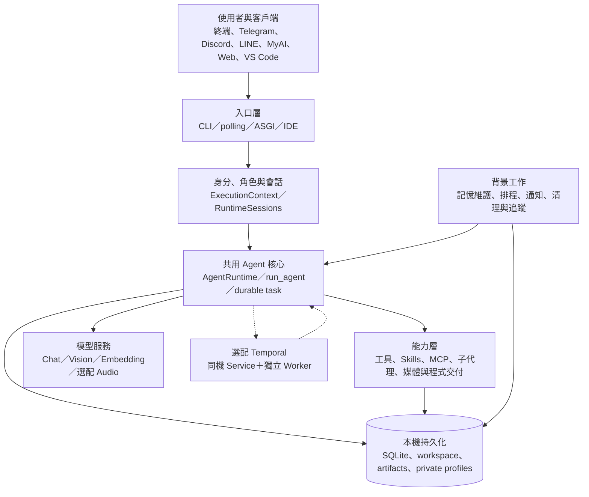

邊界說明：MyAI 是外部桌面客戶端，本 repo 提供 `/ws/v1` 與 companion protocol；不把另一個 repo 的 UI 實作畫成 PythonAI 內部模組。LLM provider、通訊平台、MCP server、GitHub／GitLab 和 Docker daemon 皆為外部依賴。

## 3. 啟動與入口路由

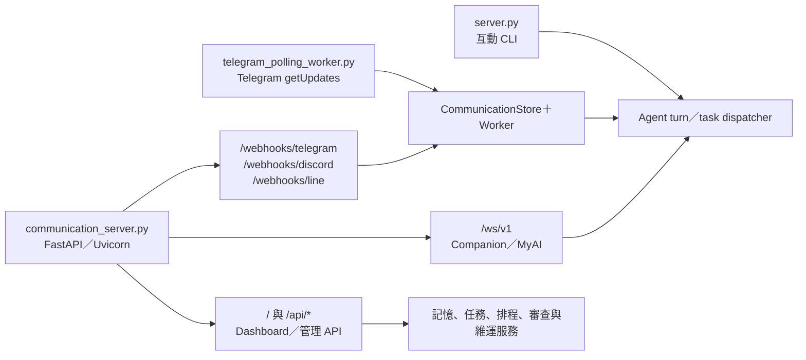

| 程序 | 啟動方式／行為 |
| --- | --- |
| CLI | `.\venv\Scripts\python.exe .\server.py`；讀取輸入、處理控制指令並執行 Agent |
| Telegram polling | `.\venv\Scripts\python.exe .\telegram_polling_worker.py`；沿用通訊去重、佇列與會話執行 |
| 統一 ASGI | `.\venv\Scripts\python.exe .\communication_server.py`；lifespan 啟停 CommunicationWorker、SchedulerWorker，結束時停止 runtime memory worker |
| IDE 專用程序 | `.\venv\Scripts\python.exe .\ide_server.py`；提供編輯器提案／autocomplete，詳見第 13 節 |
| Temporal Worker | `.\venv\Scripts\python.exe -m agent_execution.temporal_backend.worker`；需另行準備同機 Temporal Service 及一致設定 |

`create_asgi_app()` 同時掛載 `/health`、`/`、`/api/{path:path}`、`/webhooks/{adapter_name}`、`/ws/v1`。舊 stdlib `run_http_server()` 保留相容用途，不是第四套 Agent 核心。`/health` 僅回傳 HTTP 存活，不證明 provider、角色、WebSocket 或 Temporal 可用。

## 4. 一輪請求與 Agent 主流程

### 4.1 每輪準備與 Skill 分流

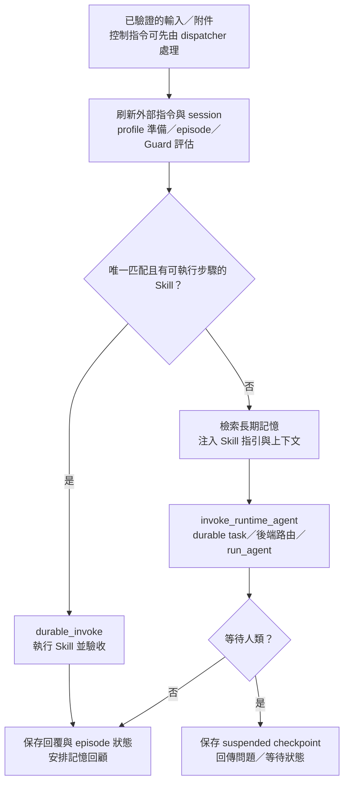

依據 `agent_runtime.run_agent_turn()`：profile 確定性命令可提前回覆；Guard 判斷與 notice 不取代工具執行端權限。多個 Skill 候選或純指引 Skill 交給模型選擇，不任意挑第一個執行。task 執行時由模型請求邊界治理 token；無 task 的相容路徑才使用既有 working-memory 摘要壓縮。

### 4.2 模型、工具與驗收迴圈

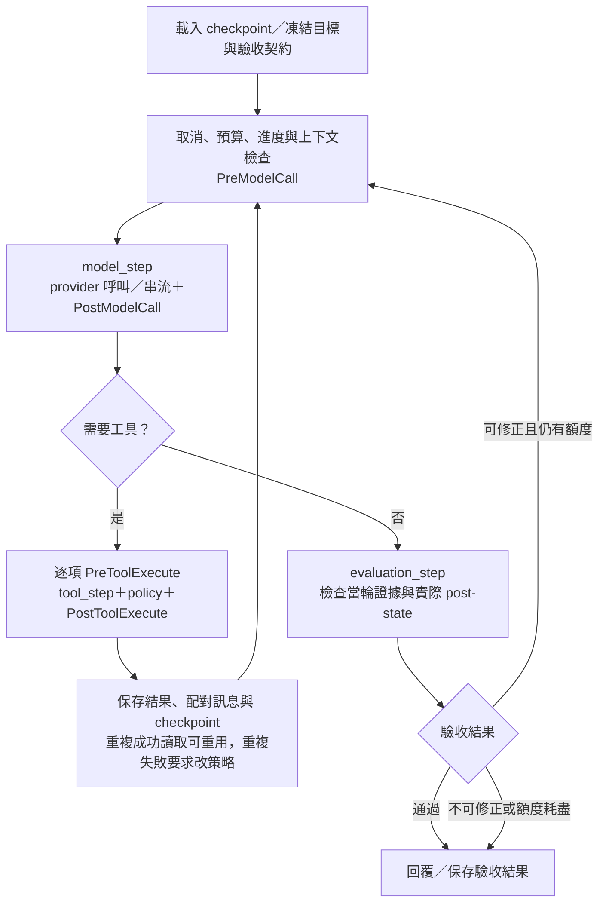

上圖收斂節點的失敗出口回傳 HITL 原因，不提供未通過驗收的候選最終答案。例外、取消、期限和批准等待可從每個執行邊界中止，詳見第 6 節。`server.run_agent()` 負責 hooks、checkpoint、provider retry、迴圈與 Critic；`turn_control/steps.py` 的共用 model／tool／evaluation step 每次只做一次 I/O 嘗試。

驗收只使用 `evaluation_start` 之後的當次任務證據；測試輸出、結構化工具結果及實際檔案狀態才是依據。權限拒絕不可自動重試，不能把拒絕的工具當成成功執行證據。

**兩種狀態不可混用**：TaskStore 的 `completed` 表示 runner 已完成；episode／驗收結果中的 `verified_completed` 表示有明確契約與證據通過驗收。回覆文字或 HTTP 200 本身不能證明驗收成功。

## 5. 工具、Hooks、權限與批准

### 5.1 共用工具管線

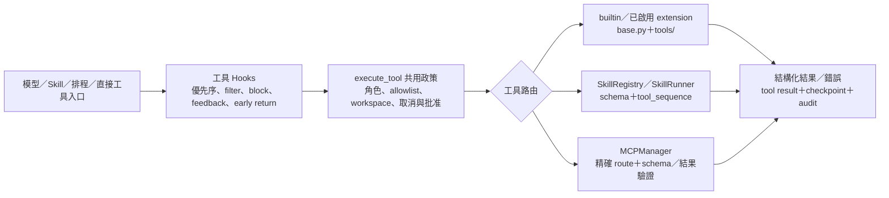

模型路徑由 `server.py` 管理 hooks，直接工具路徑由共用 dispatcher 補足，避免同一呼叫重複執行 hooks。四個生命週期為 `PreModelCall`、`PostModelCall`、`PreToolExecute`、`PostToolExecute`，事件記錄可追溯至 `hook_execution`。停用 Hook 仍不會停用核心角色、路徑及批准政策。

`base.run_tool_with_context()` 解析 JSON 參數、移除模型不得控制的 runtime 欄位，再交給 `execute_tool()`。模型看得到的 schema 先依角色與任務 allowlist 過濾，執行時仍重查；`viewer` 不允許 Skills，遠端缺少角色配置採最小權限。身分、來源、project、session、task、workspace、取消檢查等放在 `ExecutionContext`，不能靠模型參數提升。

### 5.2 一次性人工批准

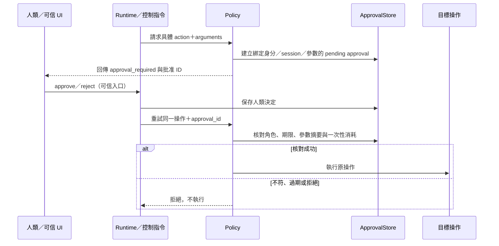

批准不是通用權杖；換參數、換 session、換身分不能重用。檔案刪除、Git 發布／合併、extension 啟用等各依其政策要求批准。Temporal 審批模式另以持久 wait／outbox 驅動 Workflow，Activity 再核對 SQLite 的批准結果，Signal 本身不授權。

`run_command` 的 host 模式與 container 模式必須區分：host 是受信任本機執行；container 模式使用 Docker、唯讀工作副本與資源／網路限制，缺 Docker 就拒絕，不自動降回 host。遠端通訊命令的既有自動確認機制不豁免 RBAC、workspace 或專屬高風險操作批准。

## 6. 持久任務、預算與恢復

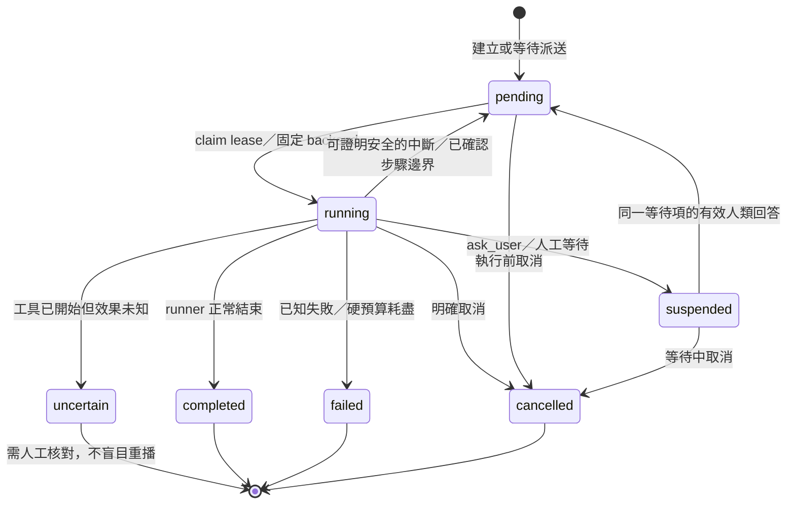

這是跨 runner 的語意總覽；實際可恢復 phase 與限制依 backend 判斷。TaskStore 保存任務目標、criteria、checkpoint、步驟、回覆與 workspace，lease＋heartbeat＋fencing 防止兩個執行者同時發布。`ask_user` 以 tool-call ID 綁定人類回答，恢復原 messages，而非另建一個無關任務。`tool_started`／`skill_started` 中斷且效果未知時要求核對；不以重送掩蓋不確定副作用。

| 治理項目 | 執行規則 |
| --- | --- |
| 根預算 | `TaskBudget` 持久化 requests／tokens／cost／deadline；子代理共享 root，不因重啟、恢復或排隊而增加 |
| 呼叫計帳 | 送出前保留保守估計；成功且有有效 usage 才結算 token，失敗／中斷／無 usage 保留預估；request 次數不退回 |
| Provider retry | SDK `max_retries=0`；由 `server.run_agent()` 有界重試並遵循錯誤分類／Retry-After，每次嘗試納入預算 |
| 模型上下文 | 保留 system、目標、驗收、批准與完整 tool-call/result 配對；必要時明確截短工具內容；權威 checkpoint 不隨模型裁剪而消失 |
| 無進展保護 | 保存重複呼叫與失敗；成功讀取可重用既有結果，反覆失敗要求改策略並限制副作用 |
| 取消／晚到結果 | 取消沿程序／工具／串流傳遞；租約失效或 session tombstone 阻擋晚到結果；已送出 provider 請求仍可能計費 |

## 7. 記憶、Profile 與背景維護

### 7.1 檢索與寫入閉環

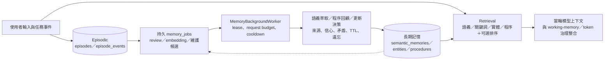

檢索由 `retrieval.py`、`retrieval_ranker.py`、`vector_search.py` 協作，使用 embedding／cosine、關鍵詞、實體與程序；存在 Hashing fallback 及選配 Laya 排序。這套 memory 檢索與 `code_index/` 的程式碼 LSH ANN 是不同系統，不應畫成同一個向量庫。前景記憶請求、背景維護及 Agent task 預算也各有治理責任。

### 7.2 身分 Profile 與隔離範圍

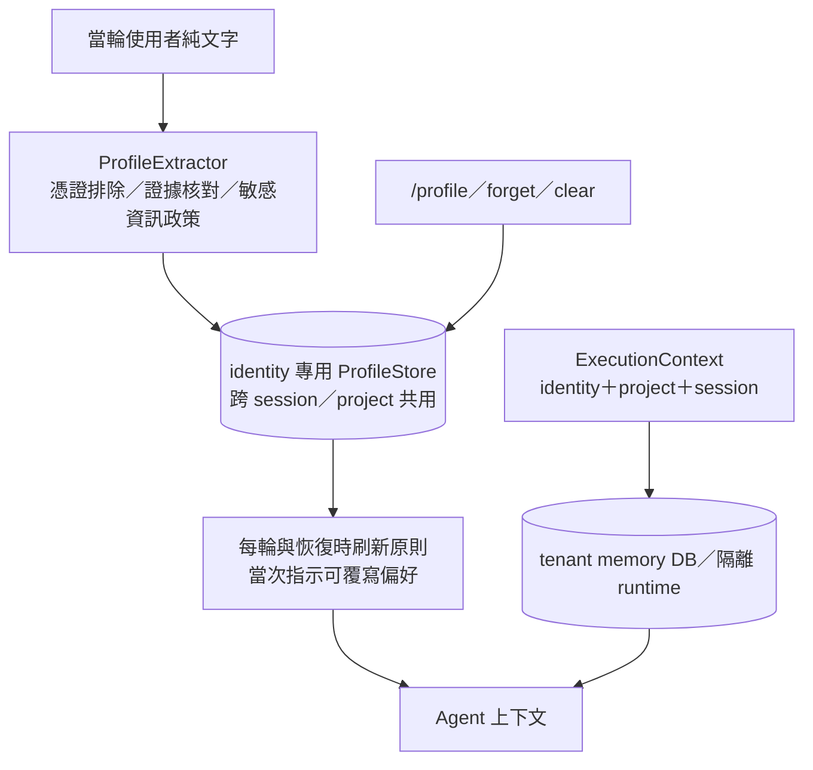

Profile 是獨立持久儲存，不等於 semantic memory 的 `user_profile` 類型。萃取失敗不阻塞一般回答；工具輸出／附件不作 profile 萃取來源。不同平台身分不自動合併，profile 不能提升角色。`/profile clear` 不會刪除其他記憶或本機手動 `profile.md`；清 session 也不等於刪 identity profile。

實體記憶路徑由 `tenant_memory_path(identity, project, conversation)` 雜湊決定。communication／WebSocket 帶 session 範圍，API 依其實作採 identity／project；RuntimeSessions 另隔離 messages 與執行鎖。本機既有 memory 路徑保留相容，不能把本機手動 profile 載入遠端身份。

## 8. 通訊佇列、附件與可靠 WebSocket

### 8.1 Webhook／polling 到回覆

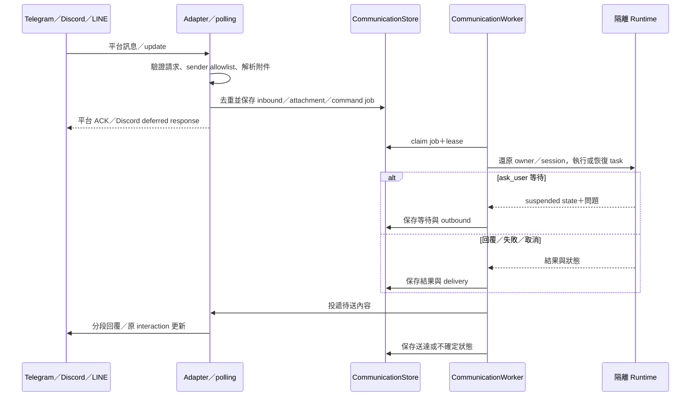

`/status`、`/cancel`、`/clear`／`/reset` 等由確定性控制流程處理。重啟只恢復符合租約及安全條件的工作；外部發送或工具副作用未知時不盲目重送。Telegram 圖片可成為 `image_url`；PDF／Office／OCR 走有界解析 worker，未知二進位明確標示不支援，不假裝已讀內容。

### 8.2 Companion／MyAI 連線與事件

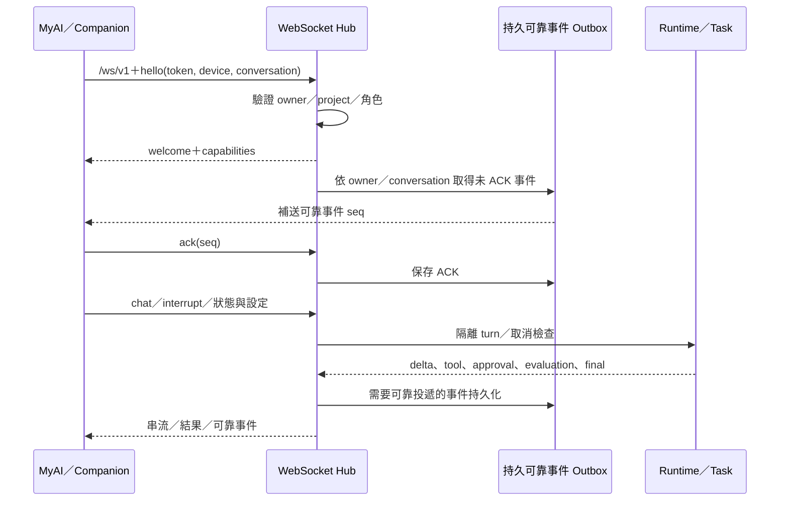

可靠事件以 seq／ACK／SQLite outbox 補送；這不表示每個文字 delta 或音訊 frame 都可在斷線後恢復。binary audio 有 stream ID、順序、frame／容量限額；取消、重連或斷線會停止 worker 並抑制舊結果。STT 回傳 `stt.result`，不自動發送 chat；TTS 透過獨立 audio API 產生有界 WAV，語音費用不由聊天 token 預算推算。

## 9. 排程與主動追蹤

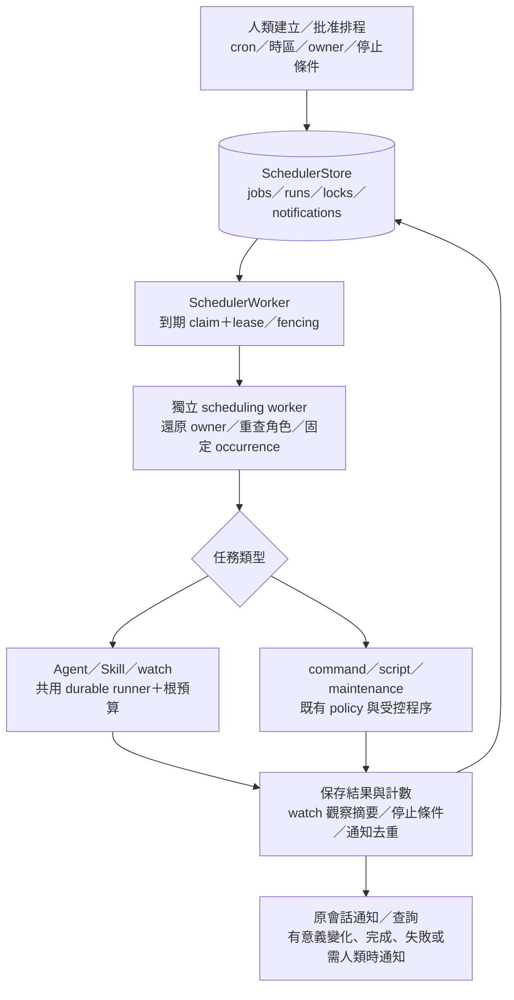

一般排程支援時區、misfire、timeout、有界 retry、max_runs；watch 使用唯讀工具及固定 JSON 契約。建立時保存 owner，執行時重查，角色撤除則停止要求處理。通訊通知只回原會話與已配置 adapter；發送不確定不自動重播。

選配 Temporal native schedule 使用第 11 節的 occurrence Workflow，只受理唯讀 `agent/watch`。新排程預設 paused，明確 resume 才開啟。舊排程不自動搬移；TP20 逐筆 `preview → stage → cutover`，回滾先停止 native 新受理並核對已受理工作，再恢復 SQLite。共享 UTC slot fence 防止跨引擎重複，既有 run_count、deadline、通知摘要不歸零，也不補跑歷史。

## 10. 子代理、Worktree 與程式交付

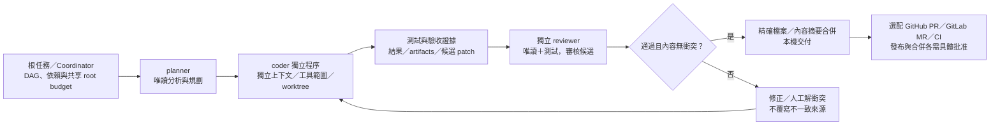

Coordinator 保存 `agent_nodes`／`agent_events`，每個節點有 persona、dependencies、owner、lease、task 和 worktree。follow-up／等待／取消與合併均透過持久狀態；不是模型在同一 messages 裡扮演多個角色。此圖顯示典型開發依賴，實際 DAG 可有多分支。

程式理解使用 `code_index/` 的增量 Python／Go／JS／TS 符號、文字／向量與 LSH 查詢，Jedi 或配置的 LSP 補語意導航；語法候選不冒充已解析語意。修改可經精確替換／AST／多檔 patch，來源 hash 不符即拒絕。`project_delivery` 以確切 SHA、CI／審查門檻及批准決定遠端發布；平台 fixture 成功不代表正式帳號驗收。

## 11. 選配 Temporal 耐久執行

### 11.1 控制面與資料面

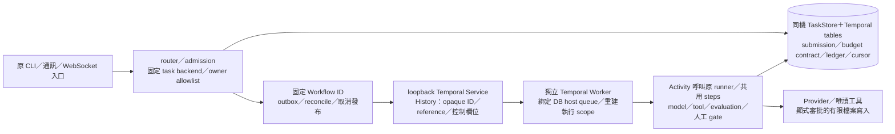

預設 `AGENT_EXECUTION_BACKEND=sqlite`，Temporal SDK lazy import。新任務固定 backend，既有 SQLite task 不隨環境變數變更引擎；Temporal task 也不能被 legacy claim。啟動 Workflow 回覆未知保留 pending，以同 ID 查詢／reconcile，不退回本機重做。

| 設定模式 | 執行方式與限制 |
| --- | --- |
| `bridge`（Temporal 預設） | M0：整段唯讀 Agent 放在一次 Activity；不支援任意跨引擎恢復 |
| `steps` | V1：在已確認 model／tool／evaluation 邊界 yield，逐步 Workflow 編排原 runner |
| `human` | V2：額外支援 `ask_user` 持久等待與文字回答續行 |
| `approval` | V3：工具批准 gate／持久決策；寫入還需 `AGENT_TEMPORAL_FILE_WRITES=1` 及明確 trial owners |

TP17 寫入僅開放契約列出的 `write_file`、`edit_file`、`create_directory`，逐次人工審批並保存檔案 journal／前後狀態；未知寫入需人工觀測／解決，不自動重播。Temporal 不支援任意 Skill、command、coordinator、副作用排程或跨機資料共享。

### 11.2 逐步執行與恢復判定

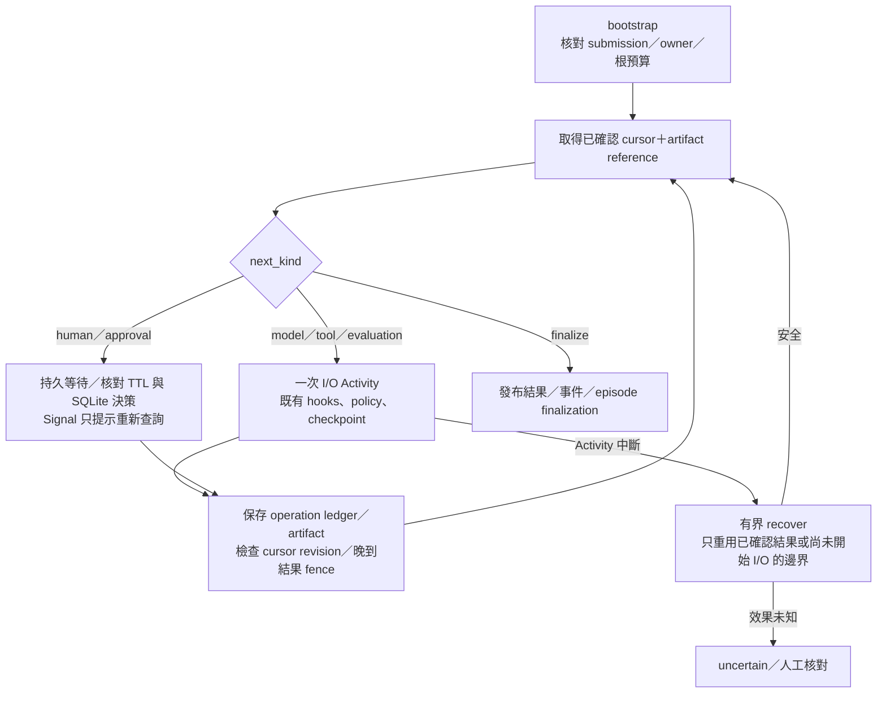

model／tool／evaluation Activity 的 `maximum_attempts=1`，metadata Activity 與驗證後 recovery 有界為 3。Workflow 只做決定性編排，不能直接呼叫模型、檔案或 SQLite。原文輸入、絕對路徑、結果與 checkpoint 留在同機私有儲存，History 僅用 opaque reference；這不是可任意換主機啟動的 distributed worker 架構。

取消傳遞、immutable budget contract、operation ledger、publication outbox 與 erasure fence 共同防止重複 I/O、重複計帳及刪除後晚到寫回。Temporal schedule 的原生 occurrence wrapper 再建立固定 owner 的 task Workflow，沿用上述步驟與本機通知 queue。

## 12. Workspace 與刪除對話生命週期

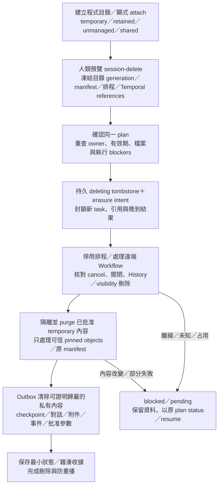

所有通道共用 `workspace_lifecycle` 協調器。CLI／通訊以 `/session-delete preview|confirm|status|resume`，Web／MyAI 使用對應 HTTP／WebSocket 流程。既有目錄預設 unmanaged；新程式未明確暫存則 retained。retained／shared 資料不因刪除一個 session 而被當作 temporary 清除；Git worktree 仍由獨立封存／還原管理。

有 live task、lease、audio／chat、memory worker 或 building 資源時會阻擋；清理不強殺外部程序。Temporal Service／Worker 離線、遠端 History 或 visibility 尚未確認時保留 pending，不先刪依賴的本機檔案。Windows 破壞操作使用 pinned handle 並拒絕連結／hard link／跨 volume 等不支援情況。

封存沒有按天數自動淘汰，永久清理須依人類確認的 session 刪除流程。purge 不可復原；邏輯刪除不保證覆寫 SQLite 空閒頁、磁碟或外部備份，也不呼叫通訊平台 API 刪除聊天室歷史。identity profile 和共用衍生記憶依各自政策處理。

## 13. 其他能力與整合流程

| 子系統 | 流程與邊界 |
| --- | --- |
| Browser | `browser_session` → owner/source/project/conversation profile → 原生 Chromium worker → actions／assertions → 私有下載／截圖；cookie 持久化不代表 live DOM 持久化；host browser 不是 OS sandbox |
| 文件／OCR | attachment → 有界 document worker → PDF page／Word paragraph／slide／sheet-row 來源單位 → 模型內容；掃描 PDF 依已安裝 Tesseract，缺失／失敗明確回報 |
| Audio | WebSocket frames → 有界 audio worker → SDK STT／TTS → result；音訊取消／重連不續接舊 stream，真裝置與正式 provider 品質另驗 |
| Desktop bridge | `desktop_tool` → 每輪 companion bridge → 客戶端工具請求／結果；僅允許 system_info／open_url／open_path／clipboard_write，角色與批准依動作核對，不提供任意桌面 shell |
| MCP | 設定 → stdio 或 Streamable HTTP → discovery／schema → 精確工具路由 → 結果驗證；失敗 server 跳過，未知 tool-call 結果不 retry；OAuth PKCE／callback／refresh 走人類登入 |
| Extension／Skill 版本 | stage → 不可變來源／digest → Docker tests → 人類批准 → activate → 重啟刷新 schema；disable／rollback 依版本，未批准不 import，啟用後仍是 trusted host code |
| IDE | VS Code selection → admin token／workspace 驗證 → 持久提案生成／UTF-8 NDJSON → editor diff → 明確單次 apply／undo；generation 端不自行讀取或修改專案檔，版本不符拒絕套用 |
| 可控改善 | Doctor／候選記憶或 persona／Skill → stage → 固定案例 A/B 與 retrieval evaluation → 改善且零回歸／副作用 gate → 人類批准／撤回；不等於自動模型訓練 |

## 14. 程序部署與運維

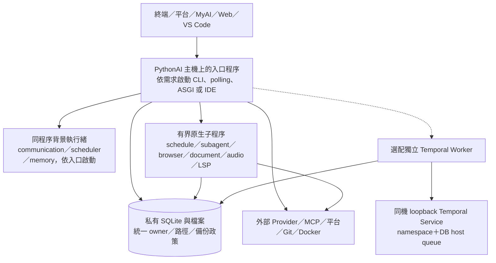

前端與 Worker 必須共用同一 TaskStore、workspace、角色、namespace 及綁定的 schedule DB。各入口啟動行為並不相同，不應假設啟動 IDE 就會啟動 webhook，或 ASGI 會自動安裝／啟動 Temporal。排程可由多個程序檢查到期，實際 claim／lease／fencing 負責避免重複受理。

觀測鏈為 `owner → trace → task → episode → coordinator node → model/tool attempt`。trace、稽核與一般摘要做 redaction，但原始對話及權威 checkpoint 仍屬私有資料。trace 失敗不重試業務 I/O，也不能取代 checkpoint 作恢復判斷。

readiness／doctor 檢查本機設定、依賴、workspace 與資料完整性，不保證 provider 可用。SQLite backup 使用 online backup；多 DB 一致快照需停 worker，restore 驗證 hash／schema 後還原到新目錄，不覆寫 live DB。瀏覽器 profiles、workspace 和外部備份需額外納入維運政策。

## 15. 資料儲存與關聯

以下是邏輯關聯圖，線表示程式 ID／reference 關係，**不表示每條線都是跨表 SQL foreign key**；不同 store 可能在不同 SQLite 檔案，不具跨 DB 原子交易。

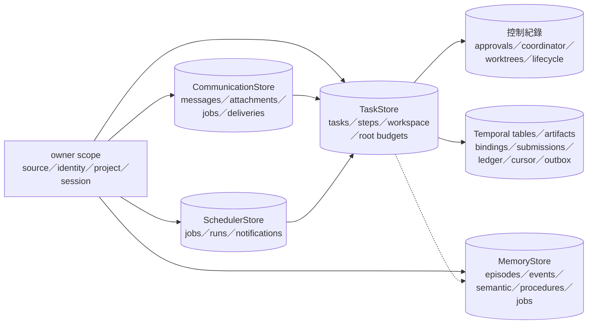

| 儲存 | 路徑／設定與主要內容 |
| --- | --- |
| TaskStore | `AGENT_TASK_DB`；預設使用者本機資料根目錄 `PythonAI/tasks.db`；tasks、steps、workspaces，及使用同一 DB 的 budget／coordinator／lifecycle／Temporal 控制表（含 native schedule binding／occurrence） |
| 本機記憶 | `MEMORY_DB_PATH` 可配置；episodes、events、semantic_memories、entities／aliases、procedures、memory_jobs、provider state |
| 遠端記憶 | `AGENT_TENANT_ROOT` 或本機使用者資料根目錄下 `PythonAI/tenants`；依 identity／project／conversation hash 建立 `memory.db` |
| Profile | tenant storage 的 identity 專用 DB；跨 session／project，不寫 Git；與一般 MemoryStore 分離 |
| 通訊 | `COMMUNICATION_DB_PATH`；預設 repo 的 `communication/communication.db`；inbound／outbound、附件、command jobs、deliveries 與去重鍵 |
| 排程 | `SCHEDULER_DB_PATH`；預設 `communication/scheduler.db`；排程、租約、執行紀錄、通知；Temporal 控制資料另與 TaskStore 關聯 |
| Worktree registry | `AGENT_WORKTREE_ROOT`；預設使用者資料根目錄 `PythonAI/worktrees/registry.db`；owner／task／repository、base、state 與 archive，與 TaskStore 的 task workspace 對應資料分開 |
| 批准 | `AGENT_APPROVAL_DB`；預設使用者資料根目錄 `PythonAI/approvals.db`；action／參數摘要／owner／期限／決定與事件 |
| Extension／改善／trace | 各自的 store；extension 版本與來源證據、改善候選／評測、owner scoped tracing，依各模組設定路徑 |
| 檔案與 artifacts | 授權 project workspace、Git worktree、Temporal reference artifacts、私有 browser profiles／下載；不可把可寫 workspace 當成憑證庫 |

前景執行、queue/outbox、lease 與重查策略補足多 store 邊界；不能由「已入佇列」推論「已送達平台」，也不能由「Workflow closed」推論「本機與遠端刪除已完成」。

## 16. 程式來源與維護索引

連結以本文件 `papers/` 為基準。後續調整入口、狀態、權限或儲存契約時，應同步更新對應圖與此索引。

| 範圍 | 實作與深入文件 |
| --- | --- |
| 功能總表 | [README](../README.md) |
| Runtime／迴圈 | [agent_runtime.py](../agent_runtime.py)、[server.py](../server.py)、[turn_control](../agent_execution/turn_control/README.md) |
| 任務／預算／驗收 | [tasks.py](../agent_execution/tasks.py)、[budgets.py](../agent_execution/budgets.py)、[context.py](../agent_execution/context.py)、[task_evaluator.py](../task_evaluator.py)、[acceptance.py](../agent_execution/acceptance.py) |
| 政策／Hooks／批准 | [policy.py](../agent_execution/policy.py)、[permissions.py](../permissions.py)、[hooks.py](../hooks.py)、[hook_policies.py](../agent_execution/hook_policies.py)、[approvals.py](../agent_execution/approvals.py)、[base.py](../base.py) |
| 通訊與 Web | [communication_server.py](../communication_server.py)、[communication_worker.py](../communication_worker.py)、[communication_store.py](../communication_store.py)、[adapters](../communication_adapters/)、[web_api.py](../web_api.py)、[sessions.py](../agent_execution/sessions.py) |
| Companion | [websocket_server.py](../websocket_server.py)、[companion](../agent_execution/companion/README.md)、[WebSocket 文件](websocket.md) |
| 記憶／Profile | [memory.py](../memory.py)、[retrieval.py](../retrieval.py)、[memory_review.py](../memory_review.py)、[memory_update.py](../memory_update.py)、[memory_worker.py](../memory_worker.py)、[profile](../agent_execution/user_profile/README.md) |
| 排程 | [scheduler.py](../scheduler.py)、[scheduling](../agent_execution/scheduling/README.md) |
| 多代理與交付 | [agent_execution](../agent_execution/README.md)、[coordinator.py](../agent_execution/coordinator.py)、[worktrees.py](../agent_execution/worktrees.py)、[git_delivery.py](../agent_execution/git_delivery.py)、[patches.py](../agent_execution/patches.py) |
| 擴充與 MCP | [skills.py](../skills.py)、[mcp_manager.py](../mcp_manager.py)、[extensions](../agent_execution/extensions/README.md) |
| 媒體／程式碼／IDE | [media](../agent_execution/media/README.md)、[code_index](../agent_execution/code_index/README.md)、[IDE](../agent_execution/ide/README.md)、[VS Code](../vscode-extension/README.md) |
| 清理 | [workspace lifecycle](../agent_execution/workspace_lifecycle/README.md)、[清理設計](workspace_cleanup_plan.md) |
| Temporal | [實作與限制](../agent_execution/temporal_backend/README.md)、[config.py](../agent_execution/temporal_backend/config.py)、[router.py](../agent_execution/temporal_backend/router.py)、[workflows.py](../agent_execution/temporal_backend/workflows.py)、[演進計畫](temportal.md) |
| 改善／維運 | [improvement](../agent_execution/improvement/README.md)、[operations](../agent_execution/operations/README.md)、[observability.py](../observability.py) |

本次為來源碼架構盤點，沒有執行正式 provider、平台訊息、裝置語音、Docker、外部 Git 平台或 production 部署驗收。各模組 README 的歷史測試紀錄只代表其標明的版本與條件；架構圖不將 fixture 通過推論為目前所有外部依賴均可用。
