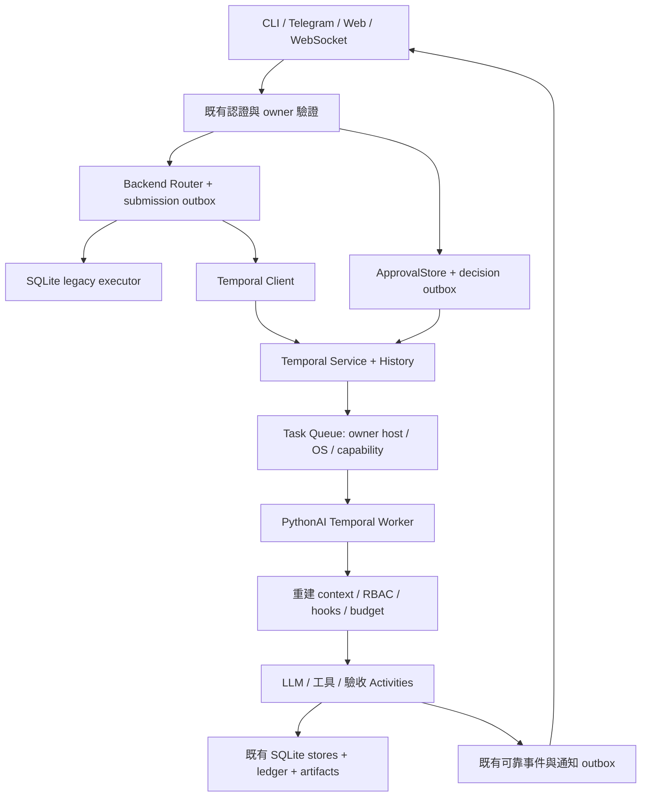

# PythonAI 導入 Temporal 詳細規劃
Temporal 在本專案是「可選、預設關閉的耐久工作流後端」，不是一般查詢流程必經元件。預設 AGENT_EXECUTION_BACKEND=sqlite，只有顯式設為 temporal，且任務有受管理的 task_id 時才會介入。

規劃日期：2026-10-17（Asia/Taipei）。文件名稱依需求保留為 `temportal.md`，產品與程式命名使用 Temporal。

流程：

```
既有入口
  │
  ├─ sqlite（預設）→ 本機 server.run_agent → 工具／驗收／HITL
  │
  └─ temporal（選用）
       ├─ 建立 backend binding 與 submission
       ├─ 交給同機 Temporal Worker
       └─ Worker 執行原有 server.run_agent 邏輯
            └─ 回覆、工具結果、驗收再投影回本機 TaskStore
```

它的主要影響：
* 耐久化與重啟恢復：Temporal Workflow History 只保存 submission ID、狀態與 artifact 引用；對話、工具輸出、checkpoint 仍留在本機 SQLite，避免敏感內容進入 Temporal History。
* 防重複執行：工具呼叫以「iteration + tool-call ID」建立穩定操作紀錄。若 Worker 中斷、回覆遺失，已完成的步驟會取回先前結果，而非再次執行。
* 不確定副作用更保守：工具已開始但無法證實完成時，任務會標記為 uncertain，要求人工核對，不會盲目重跑。
* 重試責任切分：模型供應商重試仍由既有 server.run_agent 控制；Temporal 的 model/tool/evaluation Activity 設為最多一次，避免「Temporal 重試 × 模型重試」造成重複請求。
* 預算與取消：沿用既有 task budget、deadline、角色與工具 allowlist；Temporal 不會重置配額。取消會阻止後續 I/O，但已送出的模型或外部請求無法保證撤回。
* 後端綁定不可切換：任務一旦綁定 Temporal，legacy SQLite executor 不可接手；這是為了防止兩個執行器同時執行同一工具。

狀態：**M0 Windows 同機唯讀橋接、TP09–TP12 已實作；TP13 人工回答／唯讀操作審批、TP14 取消／heartbeat／程序清理及 TP15 持久串流／finalization 去重已完成；TP16 封閉試用路由及真實 provider 唯讀 E2E 已完成；TP17 首批同機檔案審批寫入已實作；TP18 同機 erasure／retention 已實作；TP19 新排程 CRUD 與唯讀 occurrence 已完成；TP11.7 原始長任務完整產物及 TP20–TP30 待辦**。SDK 已作 optional 安裝，CLI 與隔離持久化 development service 已驗證；未修改使用者 `.env`、未啟用正式環境、未遷移使用者資料。下方完整目標架構含尚未交付項目，實際能力以本節進度及 `agent_execution/temporal_backend/README.md` 為準。

### 目前導入進度（2026-10-23）

本輪 TP19 新排程 CRUD、owner／時區／overlap／max_runs 契約及唯讀 occurrence 已實作；新增 35 項契約測試、5 項隔離真實 Service 測試；完整 venv pytest **1326 passed、12 skipped、95 subtests passed**，1299.93 秒，pip check／compileall／diff check 通過。新增排程預設 paused，舊排程切換留給 TP20；執行與操作方式見 12.10。

前輪完成 TP18：將 Temporal 刪除接入原人類確認的 frozen lifecycle 計畫，持久 reference 保護仍在執行的本機程序；核對遠端閉合及 History／visibility 查無紀錄後，才清除同 task 的執行內容與 artifacts。保留最小雜湊 fence 防復活；有界 retention CLI 預設 dry-run，不掃描刪除程式檔案。隔離 Service 的刪除／離線恢復／CLI 重入驗證通過。完整 venv pytest **1286 passed、12 skipped、95 subtests passed**，1148.42 秒；pip check／compileall／diff check 通過。archival／備份分列 external_policy_required，不宣稱已抹除正式資料，詳見 12.9 及 backend README。

前輪完成 TP17 首批同機檔案寫入：新任務以顯式旗標／owner 清單／admin 綁定 V3 審批能力，固定前後態、一次 consume、同目錄原子 replace、未知效果禁止重跑及人工觀測稽核。真實 provider 在隔離 workspace 建立 7 個 wiki 子目錄與 README，**1 passed**，18.22 秒，3 筆模型／驗收請求與 2 次審批；不改使用者正式設定／資料。完整 venv pytest **1248 passed、12 skipped、95 subtests passed**，1446.15 秒；pip check／compileall／diff check 通過。全套回歸與獨立 live 測試分開記錄，驗收詳見 12.8 及 backend README。TP18 retention／刪除接續見 12.9；TP11.7 原始長任務完整產物及其他副作用能力仍獨立追蹤。

前輪沿用現有 provider 設定完成 TP16.5：TCP／`/models` 已恢復，真實 Service／Worker 的兩個案例 **2 passed**，44.27 秒。Wiki 寫入要求在 1 筆請求後被唯讀權限拒絕，0 次工具 I/O；HarnessRouter 以 3 筆含驗收的請求完成，實際抓取 1 次。History replay、新 Worker 取回完成結果／拒絕未知狀態恢復、request 與 deadline 不變均通過，驗收見 12.7 及 backend README。此前同一程式版本的完整 venv 回歸 **1201 passed、11 skipped、95 subtests passed**，971.86 秒；兩個 live 案例當時按 opt-in gate skip，已由本輪獨立補驗，全套回歸與獨立 live 測試分開記錄。該輪只更新驗收文件，未修改程式、provider 設定或正式資料。TP16 封閉唯讀範圍完成；TP17 首批檔案寫入見 12.8，正式放量留 TP27，TP11.7 原始長任務完整產物仍獨立追蹤。

前輪完成 TP15 同機唯讀範圍的持久事件、可靠投遞及 memory／profile finalization 去重；完整驗收見 12.6 及 backend README。專案 venv 完整 pytest **1174 passed、9 skipped、95 subtests passed**，1029.94 秒；pip check、compileall、diff check 通過。真實 Temporal Service／Worker、History replay、原生 WebSocket reconnect／ACK 及兩庫故障注入通過；模型與 communication adapters 使用受控替身，真實 LLM／Telegram 送達／桌面／正式部署驗收獨立保留。TP14 取消與清理驗收見 12.5；TP13.5–13.6 操作審批交付見 12.4。

前輪接續 TP13 人工回答：新增 opt-in `human` engine／`AgentTaskWorkflowV2` 與獨立 queue，
新任務允許 `ask_user`；既有 steps V1 能力與 queue 不變。由既有 runner 保存
`waiting_user` checkpoint，再原子提交 human cursor／等待紀錄。原入口顯示問題與受理
文字回答，回答與通知 outbox 同庫提交；Workflow 只收不透明 submission 通知，Activity
重新核對並一次性消耗回答。等待由 Temporal Timer／Signal 處理，不占住 Activity thread。
TTL 固定為 300 秒與原 root deadline 的較早者；Worker 停機期間也計時，消耗時已過期的
回答不得恢復 I/O。相同回答／通知重送不重開任務，不增加 budget，不會把歷史 tool result
誤當新回答。此為前輪人工回答交付；操作審批／ApprovalStore 整合已於本輪 V3 完成，驗收見 12.4。
前輪完整 pytest **1065 passed、9 skipped、95 subtests passed**，1118.53 秒；Temporal
專項 **149 passed**（包含真實 Service／Worker 與 V1／V2 replay）。pip check、compileall
及 diff check 通過；模型使用受控回應，未重驗真實 LLM，未啟用正式設定。

本輪 TP12：新 submission 固定 root budget reference、deadline 與 limits；checkpoint 固定
iteration／provider retry／evaluation retry 上限。Provider retry 只由 runner 擁有，I/O
Activity 不重試；排隊逾期、Workflow 取消、未知效果與 late result 採不同狀態及 fence。
真實 Service/Worker 已驗證 429 後的四次實際 provider request 各計帳一次，但仍只有兩個
model Activities；排隊 Workflow 取消後模型呼叫為零。完整 pytest **1016 passed、9 skipped、
95 subtests passed**，781.06 秒；pip check、compileall、diff check 通過。本輪沒有重驗真實
LLM provider，TP11 的逾時外部驗收仍保留為未完成。

本輪 TP11：新增 `AgentTaskWorkflowV1`、六種 Activities、版本綁定與獨立 queue、確認邊界恢復及錯誤映射。最終完整 pytest **949 passed、8 skipped、95 subtests passed**，670.92 秒；Temporal／continuation 專項 **122 passed**，前置 hook 邊界專項 **35 passed**。真實 Service/Worker 的受控模型讀檔、Worker 重啟、回覆遺失、未知效果停止與 History replay 通過；pip check、compileall、diff check 通過。真實 LLM 在第一個模型步驟逾時，90 秒後取消，三筆請求預留保留、無工具執行；獨立 15 秒探測也為 `APITimeoutError`，未取得服務端根因。此項與原始長任務仍待驗收；詳見 backend README 與 `temp/temporal-tp11-provider-check/`。未啟用正式設定。

前輪 TP10 驗收：完整 pytest **902 passed、8 skipped、95 subtests passed**，764.80 秒，包含真實 Temporal Service/Worker、故障注入與 History replay。真實 LLM 也完成隔離讀檔／回覆／驗收回合，使用 **3 筆模型請求**；重取已完成工具結果未重跑或增加請求，History 不含檔案內容。另修正 stream monitor 未等待退出的 SQLite 清理競態（commit `bf7bcfd`）。pip check／compileall／diff check 通過。紀錄見 backend README、`temp/temporal-tp10-full.log` 及 `temp/temporal-tp10-provider-check/`；逐工具自動崩潰恢復仍待 TP11。

前輪 TP09 驗收：完整 pytest **853 passed、8 skipped、95 subtests passed**，590.27 秒，包含已啟用的真實 Temporal Service/Worker 測試；共用步驟新增測試 **9 passed**。pip check／compileall／diff check 通過。真實 provider 本輪未重驗，模型回合使用受控回應；這次完成共用步驟抽離，逐工具自動恢復仍待 TP11。詳細紀錄見 backend README 與本機 `temp/temporal-tp09-full.log`。

| 項目 | 狀態／證據 |
| --- | --- |
| TP01 | 完成基準：802 passed、8 skipped、95 subtests；基準 commit、dirty work 保護與備份清單見 `temporal_backend/BASELINE.md` |
| TP02 | Windows 部分完成：SDK 1.34.0／CLI 1.9.1／development Server 1.32.0，checksum、pip check、持久化重啟驗證通過；Linux／macOS／ARM 尚待實機驗證 |
| TP03 | M0 ADR 完成：Python SDK、同機 loopback、reference-only History、coarse Activity max-attempts=1，原預算／權限保留 |
| TP04–TP06 | 已實作 optional package、設定／schema v1、共用入口路由、固定 backend binding、task/submission 同庫投遞 outbox、去重及未知回覆 reconcile |
| TP07 | 已實作顯式 Worker、受限 ThreadPool、context 重建、client loop shutdown、設定診斷與同機 queue；正式 HTTP readiness／TLS／多機尚未開放 |
| TP08 | Windows 唯讀橋接已接通並完成真實 Service + Worker + 受控模型工具回合、重送、History replay、重啟取回結果；當時真實 provider 逾時紀錄保留，TP10 本輪另已通過隔離小型真實 LLM 唯讀回合 |
| TP09 | 已抽出共用 model/tool/evaluation steps；SQLite runner 與 Temporal 唯讀 Activity 使用同一實作，保留外層 hooks／checkpoint／重試與預算；驗收紀錄見 backend README |
| TP10 | 已實作版本化 operation ledger、canonical digest、雙層 fence、原子 result/evidence 引用與完整性檢查；接入唯讀 Activity 的 model/tool/evaluation，共用結果不重跑，未知結果保守阻擋；詳見 backend README |
| TP11 | 已實作 opt-in step-based Workflow／Activities、cursor references、版本綁定與確認邊界恢復；未知操作不重試。受控模型與真實 SDK 恢復／replay 已通過；TP16／TP17 已有獨立真實 provider 補驗，原始長任務完整產物仍待驗收 |
| TP12 | 已實作 root budget contract、恢復限制、retry ownership、deadline 與目前唯讀範圍的取消矩陣；驗收詳見 backend README |
| TP13 | 人工回答及唯讀操作審批完成：同庫 decision outbox、Timer／Signal、TTL、原入口通知與一次性 consume；V3 整合及驗收見 12.4，寫入仍留 TP17 |
| TP14 | 已完成目前唯讀範圍的取消 outbox、heartbeat 合作式停止、程序樹清理與 late-result fencing，驗收見 12.5；DAG 父子流程留 TP21–22，TP17 首批檔案工具不啟動命令，Docker 實機終止仍未驗收 |
| TP15 | 同機持久串流、EventStore seq／ACK 去重、communication outbox 與 memory／profile finalization 去重完成；斷線解除訂閱，明確取消沿用 TP14，驗收見 12.6 |
| TP16 | owner allowlist、共用新任務受理、唯讀隔離 E2E 及完整回歸完成；TP16.5 真實 provider 補驗 2 passed，封閉唯讀範圍完成，見 12.7 |
| TP17 | 首批同機 create_directory／write_file／edit_file 審批寫入、前後態核對、未知效果不重試與人工觀測已實作；驗收見 12.8 |
| TP18 | 同機 erasure fence、遠端閉合與 History／visibility 核對、scoped payload 清除及有界 retention CLI 已實作；驗收見 12.9 |
| TP19 | 新排程 owner-scoped CRUD、時區、SKIP／BUFFER_ONE、max_runs、獨立唯讀 task 與 erasure 整合；驗收見 12.10 |
| TP20–TP30 | 待辦；舊排程遷移、多 Agent、正式部署、多機及其他副作用能力尚未交付 |

M0 僅對明確啟用的新唯讀 Agent 任務生效。Skill、scheduler/coordinator 與 M0 未完成任務 manual resume 會拒絕；human V2 僅開放已確認人工回答邊界的續行，不開放未知效果手動重跑。已完成結果可在服務停止時由同機儲存取回。輸入上限 1 MiB、結果上限 2 MiB 是當前橋接的本機限制，TP10 已提供限額內的 JSON result/evidence 引用；大型附件／圖片與完整 retention／刪除治理仍待後續階段。完整驗收結果與安裝指令見同目錄 README；不要把本表解讀為整份導入計畫完成。

M0 程式驗收（前次交付）：完整 pytest **831 passed、8 skipped、95 subtests passed**，558.82 秒；在後續非本次的 Whisper commit `3276657` 後補做最新 HEAD 相容性回歸 **80 passed、4 subtests passed**；最終 Temporal 模組 **30 passed**（含全套後追加的純測試 rollback case，Temporal 產品程式碼未再修改），pip check／compileall／diff check 通過。真實 provider 逾時的限制保留，不以受控模型的測試結果代替真實 LLM 成功證據。

## 1. 建議決策與導入目標

建議以 **Temporal Python SDK + 獨立 Temporal Service + PythonAI Worker** 整合，採可選後端、單機先行、分階段切換。使用者提供的 [temporalio/temporal](https://github.com/temporalio/temporal) 是服務端原始碼；應用端使用 [temporalio/sdk-python](https://github.com/temporalio/sdk-python)，無須把整個 Go 服務端複製進 PythonAI，也無須先改寫成 Go。[S1][S2]

預期改善：

1. 後端或 Worker 重啟後，保留已完成的流程步驟，恢復可安全重試的工作。
2. 人工補充、審批、等待外部事件及排程改由持久化流程協調，減少常駐輪詢與等待中的執行緒。
3. 多 Agent 的依賴、取消、逾時與審查具有可查詢的流程紀錄。
4. 讓任務投遞、Worker 併發與後續擴容具有明確邊界。
5. 保留現有 CLI、Telegram polling、`communication_server.py` 統一 Web/API/WebSocket 三種啟動模式；Worker 是可選執行後端程序，不新增第四套使用者入口。

Temporal 不會自動修正 LLM 的無進展迴圈、錯誤工具選擇、模型容量不足或驗收不完整；`turn_control`、OS 提示、工具政策與預算仍必須保留。Temporal 的流程重放不等於外部副作用 exactly-once，失敗的 Activity 可能再次執行；工具仍需冪等、核對與人工處理機制。[S3]

### 1.1 本階段可採用的預設

| 決策 | 建議預設 | 原因／後續變更門檻 |
| --- | --- | --- |
| 導入方式 | SDK 整合，不 fork Temporal Server | 降低服務端維護負擔 |
| 原有後端 | `sqlite` 保持預設，可逐任務選 `temporal` | 安裝與現有使用流程不受導入阻斷 |
| 開發環境 | Windows 原生 CLI development server，明確指定持久化檔案 | 適合目前 Windows workspace，先不強迫 Docker |
| 第一個 Worker | 與 PythonAI 同機、同一服務帳號、同一受控儲存根目錄 | 現有 SQLite 與 worktree 不能直接跨機共用 |
| 第一批任務 | 新建、明確開啟的唯讀 Agent 任務 | 先驗證投遞、恢復及預算，不先開放高風險副作用 |
| 正式服務 | 小規模先評估自管 Linux + PostgreSQL；無維運人力時改評估 Cloud | 正式選型仍需確認部署位置、費用及資料政策 |
| 上線範圍 | 核心任務、安全等待先上；排程、多 Agent 後上 | 避免三套狀態機一次遷移 |

這些是規劃假設；正式部署前仍需確認主機位置、任務量、資料出境及維運責任。文件不因此阻擋先做隔離的本機 POC。

## 2. 現況盤點與整合接點

下表是本次閱讀程式所得，並非僅依歷史記錄推測。

| 現有模組 | 現有責任 | Temporal 導入後的處理 |
| --- | --- | --- |
| `agent_runtime.py`：`run_agent_turn`、`invoke_runtime_agent` | 對話、記憶、技能、profile、`durable_invoke` 橋接 | 建立後端介面；入口只受理及投遞一次，執行段由 Worker 接手 |
| `server.py`：`run_agent`、`build_system_prompt` | 模型／工具迴圈、hooks、串流、驗收、checkpoint | 先保留相容橋接，再抽出可持久化的模型、工具與驗收步驟 |
| `agent_execution/tasks.py` | `TaskStore`、owner、租約、checkpoint、人工回答、uncertain recovery | 保留 legacy 執行；Temporal 任務只保留業務索引、執行 fence 與恢復證據，不再由 legacy 排程器重啟 |
| `agent_execution/budgets.py` | 根任務預算、呼叫預留、模型槽位、子 Agent 限額 | 繼續作為額度權威，不因 Workflow Retry／重啟／Continue-As-New 重置 |
| `agent_execution/approvals.py`、`companion/approval_bridge.py` | 身分／session／操作 digest 綁定審批、一次性消耗 | 人類決定仍經原授權入口；以 outbox 通知 Workflow，執行前再核對並消耗 |
| `agent_execution/policy.py`、`permissions.py`、`hook_policies.py` | RBAC、workspace、工具 allowlist、hook | 每次 Activity 重建可信 context，再走原工具政策；Workflow 不繞過它 |
| `agent_execution/coordinator.py`、`coordinator_worker.py` | DAG、子程序、租約、review_pending、Reviewer、guarded merge | 後期改為父／子 Workflow；原 Reviewer 與 merge 驗證保留 |
| `agent_execution/scheduling/store.py`、`engine.py`、`scheduler.py` | cron、時區、occurrence、鎖、執行紀錄、通知 | 後期逐筆轉 Temporal Schedule；不能與舊 `claim_due` 同時取得同一工作 |
| `communication_server.py`、`communication_worker.py` | 共用 runtime、身分/session、入站與回覆 | 新增 submit/status/resume 橋接，保留現有傳輸協定及認證 |
| `agent_execution/delivery.py`、`communication_store.py` | WebSocket seq/ack、入站去重、可靠事件、投遞 uncertain | 保留；Temporal History 不作逐 token 串流或平台訊息投遞替代品 |
| `worktrees.py`、`workspace_lifecycle/` | 工作目錄、刪除、建置、隔離與失效保護 | 使用不透明 workspace reference；重播不能重建已刪除 session |
| `user_profile/`、`turn_control/` | 身分隔離原則、環境資訊、重複工具／迭代控制 | Activity 執行時重新載入，既有守則持續生效 |

### 2.1 已存在的限制必須先處理

- `task_owner` 現為 `[source, identity, project, session]` 的序列化值；不能只用 session 或 task_id 當跨使用者 Workflow ID。
- `TaskStore.claim` 對 `tool_started`／`skill_started` 的崩潰採保守處理；加入 Temporal 不得把它改成無條件重試。
- 現有 task checkpoint 允許到 64 MiB；不能原樣塞進 Temporal History。
- 預算目前預設 24 requests、256000 tokens、600 秒 deadline，既有任務不因環境設定改變而提高上限；審批預設 TTL 300 秒。長時間等待必須明確處理這兩種時限，而非假設能無限等待。
- `execution_scope` 與目前角色使用程序內 context；ThreadPool、子程序與獨立 Worker 不會自動取得原 HTTP／Telegram thread 的可信身分。
- 目前資料庫與檔案多為本機儲存。只有把 Worker 改成遠端，並不會自動取得同一 SQLite、profile、審批、預算或 worktree。
- 本次工作目錄已有其他未提交變更與 `workspace/communication.db` 刪除狀態；此次規劃不修改它們，正式遷移也不得把該狀態當作可直接清空資料的授權。

## 3. Temporal 原理及本專案如何使用

Temporal Service 儲存流程事件並派發工作；Python Worker 取得 Task Queue 的工作，執行 Workflow 與 Activity。服務端包含 Frontend、History、Matching 等服務；它不會直接替本專案執行本機工具或讀取工作目錄。事件歷史用於重建流程狀態，業務 I/O 應放在 Activity。[S1][S4][S5]

| 概念 | PythonAI 對應用途 | 設計界線 |
| --- | --- | --- |
| Namespace | 區隔 dev／test／prod | 非現有使用者認證或 RBAC 的替代品 |
| Workflow | 一個明確 task／schedule occurrence 的生命週期 | 不以整段永不結束的聊天為單一 Workflow |
| Activity | 模型請求、工具操作、驗收、資料投影 | 有 I/O 或非決定性的行為都在此處 |
| Task Queue | 派給具正確 OS、workspace、能力的 Worker | queue 名稱不是授權邊界 |
| Timer | 等待、審批逾期、watch 間隔 | 不用 `time.sleep` 占住 Activity 等人 |
| Signal／Update | 人工回答、審批事件、取消意圖 | API 認證與資料庫授權先完成；不是「收到 Signal 就已核准」 |
| Query | 讀流程目前進度 | 不寫資料、不更新預算、不呼叫模型；不能作最終授權依據 |
| Child Workflow | Planner／Coder／Reviewer 節點 | 子流程不可另開無上限根預算 |
| Schedule | 定時啟動新的 occurrence Workflow | 明確定義重疊、補跑、時區與停用策略 |
| Continue-As-New | 縮短長期 watch 流程歷史 | 保持 root budget、事件去重與取消狀態 |

### 3.1 決定性與重放規則

Workflow 只負責決定「下一步做什麼」及保存小型狀態，不直接執行 HTTP、LLM、SQLite、讀檔、Git、命令、profile extraction、系統時間或 OS 偵測。使用 Temporal 提供的流程時間、Timer 與狀態 API；Activity 結果作為後續決策輸入。Workflow sandbox 不是本專案執行不可信程式的 Docker sandbox，兩者用途不同。[S2][S6]

尤其不能把目前 `server.run_agent` 整段直接放進 `@workflow.run`，也不能為了讓它匯入成功就關閉 sandbox。`workflows.py` 不匯入會初始化模型、SQLite、MCP、registry 的 `base.py`／`server.py`；透過無副作用 DTO、Activity 名稱或安全的定義模組耦合。

### 3.2 兩階段落地方式

1. **相容橋接 POC**：Activity 包住受限的既有執行段，沿用 `durable_invoke` 的 checkpoint；整段 Agent Activity 設 `maximum_attempts=1`。先驗證傳輸、Worker、狀態映射及重複提交。崩潰後需人工／可信恢復程序檢查 checkpoint，不能宣稱已具備工具級自動恢復。這個 POC 不作正式交付終點。
2. **正式 MVP**：從既有迴圈抽出「模型請求 → 工具執行 → 驗收」步驟；一個工具呼叫一筆 operation ledger，Workflow 取得小型結果引用，保存下一步狀態。已完成的步驟不重跑；未完成的步驟按副作用分類處理。保持 sqlite runner 與 Temporal runner 共用步驟函式，避免複製兩份 Agent 行為。

## 4. 目標架構與執行權



### 4.1 權威資料來源

| 資料 | 權威來源 | 另一端如何使用 |
| --- | --- | --- |
| 任務由哪個引擎執行 | PythonAI task/backend binding | 第一次受理後固定，不因全域 env 改變而重選 |
| Temporal 任務執行順序、等待、Activity 結果 | Temporal History | 本機 task row 僅投影業務狀態與診斷，不另開恢復迴圈 |
| 權限、owner、session lifecycle | PythonAI 可信 stores／認證設定 | Activity 每次執行前重新核對；舊歷史不能授權新操作 |
| 預算 | `TaskBudget` 與 `budget_calls` | Workflow 僅持有 root reference 與快照，不自己另算額度 |
| 人工核准 | `ApprovalStore` | Signal／Update 只通知重新核對；最終工具使用仍須 consume |
| 工具副作用與冪等證據 | operation ledger + 實際檔案／外部系統 | Temporal 的成功事件不取代操作核對 |
| 檔案、完整模型回覆、測試輸出 | 原 workspace／受控 artifact store | History 保存引用、digest、大小、摘要 |
| WebSocket／Telegram／Web 投遞 | 既有 delivery stores | 不用 Workflow 完成事件直接宣稱訊息送達 |

狀態投影採單調 version 更新與 reconciliation；Temporal 已完成而 task row 尚未更新時補投影，不能重跑業務。投影失敗不應將已成功工具變成「可以再執行一次」。

狀態映射必須區分流程是否存活與業務是否成功：

| 業務狀態 | Temporal 狀態／動作 | UI／原 API 應呈現 |
| --- | --- | --- |
| submission_pending | StartWorkflow 結果待 reconcile | 已受理、尚未確認開始，不自動換引擎 |
| running | Workflow open，Activity 執行或排隊 | 執行中；可細分 queue_wait 與 step phase |
| suspended／waiting approval | Workflow open，durable wait | 等待使用者或核准，不顯示已完成 |
| uncertain／needs_resolution | Workflow open，等待可信 resolution 或到期終止 | 操作結果未知；禁止自行重試副作用 |
| completed 且驗收有證據 | Workflow 正常結束，業務結果通過 | 依原契約區分 completed 與 verified_completed |
| failed／needs_input | 正常返回結構化業務失敗，或經分類的流程失敗 | 原因、可否重試、已完成操作與未驗證部分 |
| cancelled | 取消協調完成；已開始效果仍另記 | 已取消；未知副作用不可隱藏 |

Workflow Task 的程式錯誤／非決定性可能使流程停住而未成為最終 Failed Execution；需另外告警與部署修正，不將「仍為 Running」誤判為工作正在前進。API 查詢同時回傳執行狀態、業務狀態及最後進展時間，避免舊前端只看成功／失敗一個欄位。

### 4.2 不允許的雙重執行

新增每任務 `execution_backend`，取值 `sqlite|temporal`，啟動後不可直接修改。Legacy task recovery、coordinator claim 與 scheduler claim 必須排除 Temporal 綁定的工作；Temporal Worker 不能處理 legacy 工作。保留本機操作租約作為活動的 fencing，與「由哪個引擎協調任務」分開。

若 Temporal RPC 超時，不得回退 SQLite 執行同一任務。先以固定 Workflow ID 查詢受理結果；未知時標示 `submission_pending`，由 outbox reconcile。只有尚未對外派發且能證明未開始的新任務，才可透過受控操作重新選後端。

## 5. 介面、資料與持久化契約

### 5.1 應用後端介面（預定）

- `submit(task_ref, input_ref, idempotency_key) -> TaskHandle`
- `status(task_ref) -> TaskStatus`
- `answer(task_ref, answer_ref, event_id)`
- `approval_changed(task_ref, approval_ref, event_id)`
- `cancel(task_ref, request_id)`
- `resolve_uncertain(task_ref, operation_ref, resolution_ref)`

所有入口先驗證認證 principal 與 task owner；不得接受模型自填的 `identity`、`role=admin` 或任意 workspace。`WorkflowHandle`、SDK Client、SQLite connection、callback 不放進 runtime messages／History。

### 5.2 ID 與 schema

建議 Workflow ID：`pythonai/<environment>/<owner_hash>/<task_uuid>`。`owner_hash` 由 source、identity、project、session 的 canonical tuple 衍生，不使用 Python `hash()`，不暴露姓名、Telegram ID 或原始路徑。Workflow ID 不是密碼或授權憑證；scope 映射仍由後端檢查。

- 固定任務 UUID 與入站 command/client-message dedup key 綁定。
- 同一 key 與同一 input digest 重送：回傳同一任務；同一 key 不同內容：明確拒絕。
- 已關閉 Workflow ID 不允許無意重用；新任務與明確再次執行使用新 task ID。實作時依鎖定 SDK 的 reuse/conflict policy API 明確設定，不依賴預設值。
- Run ID 可因 Continue-As-New 改變；應用 task ID 與 root budget ID 保持不變。
- 輸入使用帶 `schema_version` 的單一 DTO，例如 task_ref、root_budget_ref、input_ref、capability_ref、policy_version、deadline；新欄位具預設值，舊 schema 可讀。
- context 僅存受控 reference，Worker 從可信 stores 解析，拒絕未知、過期或跨 owner reference。

### 5.3 建議新增資料表

表格為邏輯 schema 草案，P01/P04 必須落成版本化 migration；不直接修改現有資料庫。

| 表 | 最低必要欄位／唯一約束 | 用途 |
| --- | --- | --- |
| `execution_bindings` | `(owner,task_id)` unique；backend、workflow_id、schema_version、host_id、input_digest | 固定任務後端與來源 |
| `temporal_submissions` | submission_id、task_ref、state、attempt、next_attempt、last_error | 受理與 StartWorkflow 間的 transactional outbox |
| `temporal_decisions` | event_id unique、task_ref、approval/answer_ref、state | DB 決定與 Signal/Update 間的 outbox |
| `operation_ledger` | `(owner,task_id,logical_step_id)` unique；arguments_digest、state、fence、result_ref、evidence_ref、updated | 去重、執行 fence 與 uncertain recovery |
| `temporal_projections` | task_ref、workflow/run_id、projection_version、phase、last_reconciled | 原 UI/API 狀態相容與修復 |

M0 實作採兩段受理：先持久化不可變 backend reservation，再於同一 SQLite transaction 建立 task 與 submission outbox。binding-only 表示未受理，不能派工或由 legacy 取得；後續重送可補齊。任一 task/submission 寫入失敗必須一起回滾，不能留下已受理但沒有 outbox 的任務。這是將原本「binding 與 outbox 同一交易」細化為 reservation 與原子受理兩步的 ADR 調整，理由與測試見 backend README。跨 `ApprovalStore` 資料庫的決定通知應將 outbox 放在 approval DB 的同一 transaction，或先做可恢復的橋接紀錄，不能假設不同 SQLite 檔案天然有原子交易。既有多個 delivery store 也遵循相同原則。

### 5.4 Payload／History 與保密

設定專案自己的保守 envelope 上限，例如 8 KiB；大量工具輸出、附件、圖片、checkpoint、diff、模型對話存為 owner-scoped artifact，History 只保留 reference、SHA-256、byte count 及必要摘要。8 KiB 是建議的應用門檻，不是聲稱 Temporal 官方限制；P02 應核對部署版本實際 payload／History 限制。[S5][S7]

Workflow input、Activity result、Signal、Update、Memo、錯誤訊息都可能成為持久資料；Search Attributes 只放允許公開給維運者的狀態與不透明 ID，不放 prompt、profile、憑證或 PII。傳輸 TLS 與 payload encryption 是不同層；需保護的 payload 使用受控 codec／金鑰管理，不能把金鑰放入 History。[S8]

Artifact 須有授權、容量、完整性檢查、retention 與備份。有效 Workflow／replay 仍需引用的資料不得被一般清理刪除；刪除 session 的流程另見第 11 節。TP10 的小型 JSON result/evidence 初期改採同機 SQLite BLOB，與 ledger 完成狀態在同一交易提交（避免檔案與 DB 的雙寫間隙）；引用帶版本、opaque ID、SHA-256 與 byte count。大型檔案後續另建受控儲存，多機前改為可信的共享服務，不把絕對 Windows 路徑當可攜 reference。

## 6. Agent Workflow 與工具執行設計

建議主流程 `AgentTaskWorkflowV1`：

1. Activity 取得可信 task input、owner、lifecycle 狀態、root budget 與允許能力；不存在或已刪除即停止。
2. Activity 建立／確認已綁定 workspace，載入當前 profile、OS、執行模式與工具 schema；指令與權限不得由 Workflow input 任意指定。
3. `model_step` Activity：共用原模型請求與 context governor，先以原預算 reserve，再呼叫 provider，保存回覆引用與 tool-call IDs。
4. Workflow 依已記錄的結構化結果選下一步；每個工具使用穩定 logical_step_id（模型步驟 ID + tool-call ID），同批獨立工具才可並行；具有檔案依賴或副作用的呼叫須依序。
5. `tool_step` Activity：載入／驗證參數 digest、ledger、fence、owner、最新角色與 workspace lifecycle，再走原 hooks／policy／sandbox。結果保存後回傳小型引用。
6. 等待使用者／核准時，先保存 waiting 狀態與關聯 ID，再用 durable wait；不把等待人類的時間塞進長 Activity。
7. `evaluation_step` Activity：套用既有 acceptance contract、TaskEvaluator 與真實證據。驗收不通過依原修正限額回到模型步驟，不新增無上限自動修復。
8. `finalize_step`：以 task+finalization_version 去重寫入最終結果、episode、profile／記憶後處理與 delivery outbox；因投影故障重試時不能重覆萃取記憶、扣額或寄訊息。

迭代上限、`TurnProgress`、evaluation_start、tool-call/result 配對與剩餘預算都需納入狀態引用，恢復後不得重置。Temporal workflow 成功僅代表協調結束；業務可以是 `failed`／`needs_input`／`uncertain`。只有驗收條件通過且證據存在才投影 `verified_completed`。

### 6.1 Activity 併發與 context

現有 runner 多為同步呼叫，初期採受限 ThreadPool Activity 或受控子程序，不能在 async Activity 內直接阻塞 event loop。每一個執行單位顯式建立 `set_current_role`、`execution_scope`、`budget_scope` 及 cancellation checker，執行後清理；不可把認證 context 視為 ThreadPool 自動繼承。SDK Workflow 本體保持輕量，不載入大型 ML runtime。[S2]

同一對話的修改型任務仍序列化，跨對話受 root budget、model slots 與工作目錄鎖限制。先設 Worker Activity 併發 2（規劃初值），再透過壓測調整；SDK slot 限制不能取代原有預算與 workspace fencing。

### 6.2 Worker OS、能力與 workspace 路由

Worker 啟動回報 host ID、OS、架構、執行模式、能力版本與可存取 workspace。queue 可採 `pythonai-dev-<opaque-host-id>-agent-v1`，由可信 registry 決定；不讓模型自由填 queue 或 host ID。不同 OS／工具能力的 Worker 不共用會導致任務漂移的 queue。

每次 Activity 的模型步驟使用**該 Worker**偵測的環境資訊；Windows 前端可連 Linux Worker，不能把前端 OS 當執行 OS。容器模式仍區分 host 檔案工具與 Linux `run_command`；持久化流程也不能因重試而從 sandbox 降級到 host。

## 7. 重試、逾時、取消與不確定副作用

Temporal Activity 預設重試可能持續多次，因此本專案必須逐類明確設定；Workflow 本身初期不啟用整體重試。時間及次數為規劃起點，必須小於該操作／根任務可用時限。[S9]

| 類型 | 初始重試策略 | 逾時／恢復方式 |
| --- | --- | --- |
| 驗證／本機小型狀態讀取 | 最多 3 次、短退避 | 單次 10–30 秒；確定性格式錯誤不可重試 |
| 唯讀 HTTP／模型請求 | SDK Activity 最多 1 次；沿用原 provider 重試 | 避免 provider retry × Activity retry；每次實際請求仍扣預算 |
| 唯讀檢查／測試 | 完成冪等／隔離分析後最多 2 次 | 有些測試會寫檔或啟動服務，不得僅因名稱含 test 就當唯讀 |
| 寫檔、Git、命令、Skill、外部訊息／發布 | 預設最多 1 次 | 用 ledger 與實際證據核對；未知結果轉 uncertain，不盲重放 |
| 狀態投影／outbox 落地 | 可有限重試，unique key 去重 | 不把平台訊息發送包在可盲重試的 transaction 裡 |
| Permission／RBAC／BudgetExhausted／deleted scope | non-retryable 業務錯誤 | 停止或等待明確新指示；不得以重試增加權限與額度 |

### 7.1 Operation ledger 狀態機

`prepared → running(fence) → completed`；執行前拒絕為 `rejected_no_effect`；已開始但 Worker 中斷或回覆未知為 `uncertain`。相同 logical_step_id 的參數 digest 不同即拒絕。`completed` 重送回原 result_ref；`running/uncertain` 不另開第二次副作用。

不能把「ledger 先寫 running」當成外部系統已完成的證據。檔案操作以內容／digest／路徑驗證；外部服務有 idempotency key 時傳遞固定 key；無查詢或冪等支援時交由人類核對。late Worker 回報須經 fence、取消狀態與 lifecycle 檢查，拒絕過期結果發布。對於已開始的外部請求，fence 只能阻止後續提交，無法讓已發出的副作用消失。

### 7.2 Timeout 與 heartbeat

- `Start-To-Close`：限制單次 Activity；`Schedule-To-Close`：限制包含排隊與重試的整段 Activity。
- `Heartbeat Timeout`：只用於長操作的存活與取消檢測；heartbeat 只放 step reference／進度，不把它當唯一 checkpoint 或副作用提交證明。
- Workflow／run 等待上限與 `TaskBudget.deadline` 分開記錄，但實際可操作時間取較嚴者。
- 初期沿用預算 wall-clock deadline，人工等待也會消耗期限；逾期就停止，不能因使用 Timer 自動暫停舊預算。若後續要「等待不計執行時間」，另做版本化 active-time policy、保留整體最長存活與審批 TTL，再以新任務／明確授權採用。
- 取消流程：可信 API 標記 cancel_requested → 請求 Workflow cancel → Activity cancellation checker → 終止子程序樹／停止後續步驟 → 寫入最終證據。僅 timeout 並不保證 OS 程序已停止；ThreadPool 工作需要合作式取消或隔離子程序。
- 強制 terminate 只作管理救援，不保證 Activity 清理；工作目錄與外部效果仍需 reconcile，不自動「回滾所有工具」。

## 8. 人工回答與審批

官方訊息模型中，Signal 適合非同步通知，Update 可回傳處理結果並使用決定性 validator；Query 只用於讀取。Update validator 不能讀 ApprovalStore／RBAC DB，動態授權應在可信入口與執行 Activity 做。[S10]

預定流程：

1. 工具經既有政策建立 approval request，儲存 identity、session、action、arguments digest、TTL 與 task/step 關聯。
2. Workflow 保存等待的 approval_ref，透過原 delivery outbox 告知使用者。
3. 使用者 `/approve`／`/deny`／桌面審批仍由既有認證入口處理；資料庫決定成功的同一 transaction 寫入 decision outbox。
4. dispatcher 送 Signal `approval_changed(event_id, ref)`；重送依 event_id 去重。通知可以先於 Workflow 進入 wait 到達，需先記錄再由 wait_condition 消費，避免漏接。
5. Workflow 喚醒後由 Activity 重新核對最新角色、scope、TTL、digest 與 task lifecycle；工具執行在原政策內 consume 一次性核准。
6. 核准消耗與工具完成間崩潰：ledger 轉 uncertain，人工核對；不能為了重試而重新啟用已消耗 approval。
7. 回答及 resolution 也以可信 reference 傳入，拒絕模型自行送出審批事件。訊息送達 Temporal 不等於使用者授權有效。

MVP 優先 Signal + outbox，若 UI 需要同步確認「Workflow 已接受回答」再增加 Update；跨 Continue-As-New 的事件去重紀錄保留在持久 store。TTL 超過時通知逾期，重新提出操作須走新 request，不延長舊核准。

## 9. 排程與多 Agent 遷移

### 9.1 排程

以 Temporal Schedule 對應現有 scheduled job，每次 occurrence 啟動新的 task Workflow。沿用原 job owner、時區、max_runs、notification 設定及執行類型驗證；啟動 Activity 前再次核對使用者目前權限。Schedules 的重疊與補跑須明確設定，不直接用 Workflow cron 代替全部現有行為。[S11]

建議預設：watch 採 `SKIP` 避免舊觀察累積；需保留一次待跑需求的任務評估 `BUFFER_ONE`（保留第一個待跑需求，後續重疊觸發略過，並非只保留最新需求）；有寫檔／發布副作用的任務不得開 `ALLOW_ALL`。時區沿用儲存值，只有新建且未指定時依產品規範選 Asia/Taipei；不把所有既有 UTC job 改成台北時區。

逐筆遷移程序：

1. 建立 schedule mapping，保存舊 next_run、run_count、timezone、owner、payload digest 與最後 occurrence。
2. 檢查該 job 無活躍 lease；有在跑的 occurrence 先排空或維持舊引擎，不能半途接手。
3. 建立 paused Temporal Schedule，驗證未來 10 次觸發時間及 DST 案例。
4. 使用 cutover fence 停止舊引擎 claim，記錄切換時間；reconcile 後解除 Temporal pause。
5. 補跑預設關閉；需要時先產出 occurrence 清單與副作用評估，再明確執行，不能自動補跑停機期間所有寫入任務。
6. `max_runs` 按邏輯 occurrence 計一次，Activity retry 不增加業務 run_count；取消、重試及人工再次執行的計數契約須測試。
7. 回滾先 pause Temporal、排空／核對活躍 occurrence，再恢復舊引擎的下一個未執行時間。

### 9.2 多 Agent

父 Workflow 管理 DAG，Planner、Coder、Reviewer 分別為 Child Workflow。只有依賴成功才可啟動；使用共享 root budget、child count/depth 與穩定 child ID。Coder 的 `review_pending` 不等於完成；Reviewer 仍須獨立回傳嚴格 approve/findings，原 guarded merge 核對 base/content 與管理者授權照舊。

單機先保留每個 Coder 的隔離 worktree；取消父流程的 Child Cancellation／Parent Close Policy 必須顯式選定並測試。不能讓父 Workflow 結束後留下仍可寫入的孤兒子程序；遲到結果不得越過取消 fence。Temporal 子 Workflow 不取代程式碼審查與 merge conflict 處理。

## 10. 目錄、相依套件及啟動規劃

新增能力集中於既有 `agent_execution` 下的獨立目錄，不將新程式散落根目錄：

```text
agent_execution/temporal_backend/          # 預定新增
  __init__.py                            # 不在 import 時連線或啟動 Worker
  README.md
  requirements.txt                       # 鎖定相容 temporalio 與必要 dependencies
  requirements-test.txt                  # async test 等測試相依
  config.py                              # 設定驗證與 secret references
  contracts.py                           # 無副作用、版本化 DTO
  backend.py                             # 應用端介面實作
  client.py                              # 一個 event loop 的 Client 生命週期
  workflows.py                           # 決定性主／子流程
  activities.py                          # 原 runner / policy / budget 橋接
  worker.py                              # 顯式 Worker entrypoint
  ledger.py                              # 冪等與 fence
  outbox.py                              # submit / decision dispatcher
  projection.py                          # 業務狀態同步及 reconcile
  schedules.py                           # schedule CRUD / migration bridge
  migrations/                            # schema version 與可重入 migration
  deployment/                            # 自管設定、服務啟停與 compose 範本
  scripts/                               # preflight、smoke、migrate、rollback
  tests/                                 # unit / integration / replay / chaos
  fixtures/                              # 去識別的 history 與 crash fixtures
```

需修改的既有接點：`agent_runtime.py`、`server.py` 的共用步驟抽取；`tasks.py` 的 backend binding／legacy filter；`communication_server.py`、CLI startup 與 `communication_worker.py` 的 backend router；scheduling/coordinator 的 claim filter；workspace deletion hook；`pytest.ini` 新增測試目錄。實作時逐項檢查 builtin manifest、operations benchmark 指紋及既有 policy tests，不能省略新工具／模組的登錄要求。

SDK 採可選安裝與 lazy import，`sqlite` 模式不要求 Temporal 套件與連線。避免直接 `pip freeze` 覆蓋整份根 requirements。先檢查現有 protobuf、pydantic、cryptography 與 Python ABI 的解算相容性，鎖定 SDK／Server／CLI／schema migration 版本和映像 digest，將實際選定版本及來源寫入部署紀錄；不使用未驗證的「latest」作正式環境鎖版。

### 10.1 預定設定

| 設定 | 開發建議值／用途 |
| --- | --- |
| `AGENT_EXECUTION_BACKEND` | `sqlite`，只影響新任務 |
| `AGENT_TEMPORAL_ADDRESS` | `127.0.0.1:7233` |
| `AGENT_TEMPORAL_NAMESPACE` | `pythonai-dev` |
| `AGENT_TEMPORAL_TASK_QUEUE` | 由可信 host/capability registry 派生 |
| `AGENT_TEMPORAL_WORKER_ID` | 本機持久化不透明 ID |
| `AGENT_TEMPORAL_ACTIVITY_CONCURRENCY` | 初始 2，受原模型／任務上限約束 |
| `AGENT_TEMPORAL_CONNECT_TIMEOUT_SECONDS` | 初始 10，僅連線控制，不延長任務 deadline |
| `AGENT_TEMPORAL_TLS` | 本機 loopback 開發可關；遠端部署必須依服務政策啟用 |
| `AGENT_TEMPORAL_API_KEY_FILE`／TLS cert references | 受控檔案／secret manager，不寫 History 或 Git |
| `AGENT_TEMPORAL_ARTIFACT_ROOT` | 受控資料根目錄，不能任意使用者覆寫 |

以上為新設定草案，尚不存在於本專案。服務啟動時只對已啟用的後端做診斷；`temporal` 連線失敗時 readiness 應顯示不可派工，不能假裝成功或靜默回退。`/health` 的 HTTP liveness 與 Worker poller／Temporal readiness 分開呈現。

### 10.2 Windows 本機導入操作順序

以下命令是未來實作的操作手冊，**本次未執行安裝或啟動**。SDK 與新增 Python module 的命令須等對應檔案完成後才可執行。

1. 依 [官方 CLI 安裝頁](https://docs.temporal.io/cli/setup-cli) 下載符合 CPU 架構的 Windows binary，解壓並加入 PATH；記錄版本與來源。[S12]
2. 在 PowerShell 驗證 `temporal --version`、`temporal server start-dev --help`，確認選定版本支援以下 flags。
3. 建立獨立持久化資料目錄；不要放在 Git 追蹤的 workspace DB：

   ```powershell
   $temporalData = Join-Path $env:LOCALAPPDATA 'PythonAI\temporal-dev'
   New-Item -ItemType Directory -Force -Path $temporalData
   temporal server start-dev --ip 127.0.0.1 --port 7233 --ui-port 8233 --namespace pythonai-dev --db-filename (Join-Path $temporalData 'temporal.db')
   ```

   開發 server 預設資料不跨程序保留，所以重啟驗收必須指定 `--db-filename`；Web UI 預設使用 gRPC port + 1000。此服務只用於開發驗證，不作正式 HA 方案。[S13]

4. 在另一個 PowerShell 視窗，以本專案 venv 安裝通過解算並已鎖版的 optional requirements：

   ```powershell
   .\venv\Scripts\python.exe -m pip install -r agent_execution\temporal_backend\requirements.txt
   .\venv\Scripts\python.exe -m pip check
   ```

5. 先執行 preflight/migration dry-run，再啟動第一個同機 Worker：

   ```powershell
   $env:AGENT_EXECUTION_BACKEND = 'temporal'
   $env:AGENT_TEMPORAL_ADDRESS = '127.0.0.1:7233'
   $env:AGENT_TEMPORAL_NAMESPACE = 'pythonai-dev'
   .\venv\Scripts\python.exe -m agent_execution.temporal_backend.worker
   ```

6. 以目前既有 CLI 或 `communication_server.py` 啟動應用，僅對測試 owner 開啟 Temporal；主程式不因每個 HTTP request 建立新 Worker。Client 不跨 fork、不同 event loop 不直接共用 SDK handle；同步入口以單一受控 loop bridge 轉接。
7. 先完成一個無外部副作用 smoke task，再依第 13 節做 restart／duplicate／cancel／approval 驗收，確認 UI 與實際檔案證據一致。
8. Worker 與服務需正常停止及註冊服務生命週期；未來若用 `Start-Process` 背景啟動，採隱藏視窗、絕對路徑、受控 log 與 PID 管理，不要求使用者長期手動維持終端視窗。

Linux/macOS 使用對應 CLI 安裝與 `.venv/bin/python` 路徑；服務資料路徑使用該 OS 的應用資料目錄。正式 Linux Temporal Server 可搭配 Windows Python Worker，前提是網路、認證及 host-scoped queue 已驗證，不需為服務端所在 OS 改寫 Windows 工具策略。

### 10.3 正式部署

評估方案：自管 Linux Temporal Service + PostgreSQL persistence／相容 visibility 配置，或 Temporal Cloud。先根據鎖定版本的自管部署文件驗證資料庫版本、schema 建置、visibility、服務配置與升級順序；不把本機 development SQLite 檔直接當正式叢集資料庫，也不預設必須加 Elasticsearch。[S14]

部署清單：獨立 dev/test/prod namespace；gRPC 與 UI 網路限制；TLS/mTLS 或服務支援的認證；Worker secret 管理；metrics／logs；時間同步；服務與 PostgreSQL 備份；復原演練；保留期間與 artifact 清理；應用端 RBAC；輪替憑證與 codec 金鑰；server/SDK 升級責任。Cloud 費用／區域／資料政策在正式選型時依官方當期方案估算，本文件不填未驗證價格。

## 11. 資料遷移、刪除與回滾

### 11.1 任務遷移規則

| 現有狀態 | 遷移處理 |
| --- | --- |
| completed／failed／cancelled | 維持原歷史，不轉成新 Workflow 重跑 |
| pending 且未開始 | 可受控轉入；同一 transaction 固定 backend，先 outbox 再派發 |
| running 且租約有效 | 留在原引擎完成，不搶占 |
| suspended／waiting approval | MVP 先留原引擎；後期僅在有完整 task/step/approval 關聯與無活躍 worker 時移轉 |
| tool_started／skill_started／uncertain | 先人工核對副作用，不能直接匯入後自動恢復 |
| coordinator review_pending | 舊 reviewer/merge 流程排空，或使用專門 mapping 轉換；不當一般 pending task |

migration 工具需 dry-run、owner 範圍、數量上限、備份 reference、逐筆結果及可重入 idempotency key。切換前保存資料庫 schema/version、配置與工作目錄證據；遷移中斷不影響未選中的任務。

### 11.2 Session／workspace 刪除

刪除流程先標記 lifecycle tombstone，阻止新提交、活動執行與晚到投影；取消相關 Workflows、Schedules、子流程及本機程序，完成核對後再依原刪除計畫清除業務資料與 artifacts。新增 hook 必須接到現有 `workspace_lifecycle/erasure.py`，不能只刪本機 task row 卻留下可再喚醒的遠端 Workflow。

Temporal History、visibility、archival、備份與 artifact 各有 retention；「本機清除」不等於遠端歷史已立即抹除。正式上線前制定閉合流程、刪除執行、歸檔／備份到期與金鑰銷毀策略及可稽核證據。MVP 優先不把對話全文／profile 放 History，降低刪除與保密負擔。保留最小 tombstone 期間也需符合資料政策，不可永遠保留可識別資料。

### 11.3 回滾

1. 將新任務路由恢復 `sqlite`，但已有 Temporal binding 的任務仍交 Temporal。
2. 暫停新排程觸發，保持相容 Worker 處理既有流程；必要時先停止派發再核對 Activity，不直接同時開兩個引擎。
3. 已執行或未知副作用的 Temporal 任務，不變更 task ID 投入 legacy 當作沒做過；人工 resolution 後才決定結束或建立明確的新任務。
4. 配置回滾與程式回滾分開；不能部署不認得現有 Workflow History 的舊 Worker。
5. 資料表採 additive migration，首輪不刪 legacy schema；資料庫還原必須考慮已發生的外部副作用，不能只恢復舊 DB 就假設回到舊世界。

## 12. 依賴順序、待辦事項與里程碑

以下為完整工作分解，已交付進度以上方「目前導入進度」為準；每項程式變更附測試及獨立可回退 commit。工期以一名熟悉專案的工程師估算，測試／驗收已計入，外部部署等待與新需求另計；不是承諾交付日。

| ID | 工作／具體交付 | 前置 | 驗收條件 |
| --- | --- | --- | --- |
| TP01 | 固定 repo 基準、盤點 dirty files、完整 baseline 與資料庫備份清單 | 無 | 可辨識本次 scope；未提交資料不被覆蓋 |
| TP02 | 鎖定 SDK/CLI/Server 與依賴；Windows/Linux 安裝及 persistence POC | TP01 | pip check；development server 重啟資料仍存在；版本清單 |
| TP03 | ADR：後端選擇、狀態權威、owner/ID、deadline 與副作用政策 | TP01–02 | 決策與本文件一致，差異有理由及驗收更新 |
| TP04 | `temporal_backend` 目錄、DTO、設定、optional import、migration scaffolding | TP03 | 無 SDK 的 sqlite 模式正常；設定錯誤明確 |
| TP05 | Backend interface/router 與 immutable execution binding | TP04 | 同一任務不會因 env 改變切換引擎 |
| TP06 | submission outbox、StartWorkflow 去重與 reconcile | TP05 | 受理前後任意崩潰，只產生一個邏輯任務 |
| TP07 | 同機 Worker、受控 loop/thread/context、shutdown、readiness | TP04 | 可信 context 不串用；連不上服務不回退執行 |
| TP08 | 唯讀相容橋接 POC、checkpoint 與狀態投影 | TP06–07 | 正常完成／重送／重啟可診斷；明確維持 max-attempts=1 限制 |
| TP09 | 已實作：抽出共用 model/tool/evaluation step，legacy runner 保持行為 | TP08 | 原 suite 通過；sqlite/Temporal 同一案例結果相容 |
| TP10 | 已實作：operation ledger、digest、fence、JSON artifact references | TP09 | completed 不重跑；未知結果保守停住；參數變更拒絕 |
| TP11 | Step-based `AgentTaskWorkflowV1`、工具分類與錯誤映射 | TP09–10 | History 無模型／檔案 I/O；副作用 max-attempts=1 |
| TP12 | root budget、provider retry ownership、迭代/驗收限制傳承 | TP11 | Activity retry/Continue-As-New 不增加額度；舊預算仍有效 |
| TP13 | 人工回答／審批 outbox、通知、等待、TTL 與一次性 consume | TP10–12 | 重送、早到事件、逾期與跨 owner 都有覆蓋 |
| TP14 | cancellation、heartbeat、子程序樹清理、late-result fencing | TP11–13 | 取消後無新工具／發布；未知效果列為 uncertain |
| TP15 | 串流 EventStore、最終狀態、memory/profile finalization 去重 | TP11 | 斷線重連不重開任務、不重複記憶及最終投遞 |
| TP16 | 新任務 opt-in、唯讀封閉試用及隔離 E2E | TP12–15 | 核心 fault tests 通過；兩個原始案例無無限重試 |
| TP17 | 開放寫入工具前的 idempotency／resolution／acceptance 驗證 | TP16 | 寫入後回報前崩潰不盲重做；既有 reviewer/approval 不被繞過 |
| TP18 | session/workspace 刪除與 retention／artifact GC hooks | TP13–17 | 已刪除任務不能復活；遠端留存有明確處置證據 |
| TP19 | Schedule CRUD bridge、owner/時區/overlap/max_runs 契約 | TP16 | 新 schedule 可 pause/resume/cancel；設定行為可預測 |
| TP20 | 舊 schedule dry-run/cutover/rollback 工具與 occurrence fence | TP19 | 雙引擎切換不重跑；DST／停機補跑案例通過 |
| TP21 | DAG 父/子 Workflow、shared budget、Coder/Reviewer 狀態映射 | TP17 | 嚴格 review_pending/approve/findings 行為不變 |
| TP22 | worktree／merge／取消父子流程與孤兒清理 | TP21 | conflict／人工 merge 權限／late child 結果測試通過 |
| TP23 | History/artifact 容量治理、Continue-As-New、事件去重 | TP18–22 | 長期 watch 不膨脹；新 run 延續同一預算與去重狀態 |
| TP24 | replay fixtures、V1/V2／patch 升級與回滾演練 | TP11、23 | 舊 histories 可回放；不相容版本不誤派 |
| TP25 | metrics/tracing/log redaction、告警、readiness 與 runbook | TP16–24 | 可追 task→workflow→step→provider；無 secret 洩露 |
| TP26 | 正式自管／Cloud 選型、部署／備份／恢復與權限 | TP02、25 | 安全與復原清單通過；真實還原演練完成 |
| TP27 | 小流量 canary、壓測、逐 owner 放量、停止條件 | TP18、24–26 | 按第 13 節 SLO 實測；有可執行 rollback |
| TP28 | 桌面／frozen Python 相容性與 OS/能力路由驗證 | TP07、27 | 原三種啟動模式保留；Windows/Linux 實機證據分開 |
| TP29 | 多機前置：集中化資料權威／artifacts／secrets／workspace routing | TP27–28 | 拔掉任一 worker 仍可在授權主機恢復，非 SQLite 檔案硬共享 |
| TP30 | 移除已遷移的 legacy 輪詢與清理過渡旗標 | TP27，且 legacy 排空 | 無存量依賴；觀察期與 rollback 保留期已過 |

### 12.1 里程碑與交付界線

| 里程碑 | 任務 | 預估投入 | 可交付結果 |
| --- | --- | --- | --- |
| M0：技術驗證 | TP01–08 | 4–7 工作日 | 本機持久服務、可選後端、受限唯讀橋接；非正式工具級恢復 |
| M1：核心 MVP | TP09–18 | 12–18 工作日 | Step-based Agent、預算、審批、取消、串流、寫入保護與刪除；可封閉試用 |
| M2：流程擴充 | TP19–24 | 8–12 工作日 | 排程與多 Agent 遷移、長歷史治理、版本相容 |
| M3：正式單機 Worker 上線 | TP25–28 | 7–10 工作日 | 監控、正式服務、canary、跨平台／包裝驗證 |
| M4：按需求擴容 | TP29–30 | 另估 | 集中化資料後多機；最終排空 legacy |

M0–M3 合計約 **31–47 工作日（約 6–10 週）**；範圍假設既有 SQLite 與工具 API 保持相容、不 fork Temporal、不一次搬遷全部歷史。若只做 M0，不能對外宣稱已完成 Temporal 導入或所有工具都能崩潰後自動恢復。

### 12.2 TP11 的實作順序與進度

TP09–TP10 已具備共用 I/O steps 與 operation ledger。TP11 已拆分 Workflow，以可持久化邊界續行共用 runner，每次只執行一個邏輯步驟；不從頭重做整段任務。範圍限同機唯讀，人工等待／審批與寫入分別留在 TP13／TP17。

- [x] TP11.1：定義版本化 task-state／step-result DTO，以 artifact references 保存 messages、iteration、provider attempt、eval retry、progress、tool-call/result 配對與 evaluation_start；History 僅留有限控制欄位。
- [x] TP11.2：抽出單輪決策與狀態轉移，拆清 bootstrap、model、tool、evaluation、finalize 的輸入／輸出；既有 SQLite runner 保留原行為，避免建立第二套 hooks／policy／驗收邏輯。
- [x] TP11.3：新增 `AgentTaskWorkflowV1` 與獨立 Activities。Workflow 不載入資料庫、profile、環境偵測、模型或檔案工具；Activity 每次重建可信 owner、目前角色、workspace／worktree、profile／OS 與原 root budget。
- [x] TP11.4：將 workflow type／協定版本持久化綁定到 submission，舊 M0 任務仍由舊 Workflow 處理；新增唯讀 opt-in 路由與版本相容測試，不用環境切換偷偷遷移存量任務。
- [x] TP11.5：串接 TP10 穩定 step ID、結果引用與 fence，已完成結果重用；running／uncertain 不重送外部操作。明確設定 model／HTTP／工具 Activity max-attempts=1，provider 重試擁有者、次數與預算不得相乘或重置。
- [x] TP11.6：錯誤映射至少區分已知拒絕、預算耗盡、取消、缺 artifact／校驗失敗及未知效果；保留原 iteration／critic 上限，人工輸入需求在 TP13 完成前明確停止。
- [ ] TP11.7（程式驗證已進行，外部驗收未完成）：以真實 Service/Worker 做逐步中斷與重啟、結果提交後回覆遺失、未知效果停止、跨 scope、root budget 計數不增與新舊 History replay；再通過完整 pytest、compileall、pip check、diff check，建立對應 commit。真實 provider 的小型成功與原始長任務驗收分開記錄。

實作見 `temporal_backend/{contracts,context,step_store,step_activities,workflows}.py` 及 `turn_control/continuation.py`。`AGENT_TEMPORAL_ENGINE=steps` 僅影響新受理的 Temporal 任務，預設為 `bridge`；存量任務的 protocol／queue 不改派。Worker 同時服務兩個版本，並共享 host 併發上限。最多 1024 個步驟、三次經核對的 Workflow 恢復；model／tool／evaluation Activity max-attempts=1，bootstrap／recover／finalize metadata 最多三次。只有已確認完成邊界或 ledger 證明 I/O 尚未開始才恢復；`step_preparing`（前置 hooks 未確認）與 `tool_started`（包含 raw result 已提交但完成 hooks 未確認）一律 uncertain。回滾新任務旗標時仍須保留此版 Worker 服務已綁 steps 的存量工作。

TP12 的完整預算／provider retry ownership 矩陣與 TP13 人工回答／唯讀操作審批已完成，交付與驗收分列於 12.4。TP11.7 原始長任務完整產物仍需追蹤；本輪真實 provider 的唯讀補驗見 12.7，不以唯讀拒絕代替寫入產物驗收。

### 12.3 TP12 預算、retry ownership 與取消矩陣

TP12 不提高任何既有額度，也不把 Activity retry 當作 provider retry。根預算仍以
`task_budgets`／`budget_calls` 為權威，逐步 Workflow 只保存與核對本機 budget contract；
History 不包含 owner、limits 或用量明文。實作及驗收順序：

- [x] TP12.1：為新 Temporal submission 原子綁定 root budget reference、deadline 與 immutable limits digest；既有 submission 相容讀取，設定重載、Worker 重啟與恢復不得增加舊額度。
- [x] TP12.2：將 iteration、provider retry、evaluation retry 上限一併寫入 checkpoint；恢復時以已保存值為準，呼叫端或環境不能放大。限制值與 snapshot schema 需 fail closed。
- [x] TP12.3：集中定義 retry ownership：OpenAI SDK hidden retry=0、provider retry 只在 `server.run_agent`、model/tool/evaluation Activity max-attempts=1、metadata Activity 最多 3、verified recovery 最多 3；每次實際 provider request 各自保守預留一次。
- [x] TP12.4：根 deadline 同時限制 client wait、Workflow execution timeout、model slot／stream／retry backoff 與每個新步驟；排隊逾期可證明無效果時終止為 failed，執行中逾期且效果未知時維持 uncertain。
- [x] TP12.5：建立目前唯讀範圍的取消矩陣：dispatch 前、host slot 等待、model 前／中、tool 前／後、projection/finalize 與 late result fencing；Temporal CANCELED 投影為 cancelled。人工等待與共用取消已分別由 TP13／TP14 擴充；子 Workflow 留 TP21–22，寫入／Docker 實機子程序樹終止仍留 TP17。
- [x] TP12.6：以真實 Service/Worker 驗證 provider retry 不與 Activity retry 相乘、結果回覆遺失不增加 request、舊 budget contract 重啟有效、deadline／取消不發布 late result、新舊 History replay；完整 pytest **1016 passed、9 skipped、95 subtests passed**，pip check、compileall、diff check 通過。本輪使用受控 provider 驗證 retry ownership，TP11 真實 LLM 逾時驗收仍未完成。

### 12.4 TP13 人工回答與操作審批的交付拆分

TP13.5–13.6 的實作順序（2026-10-20）：先在 ApprovalStore 同庫建立 operation binding 與
decision outbox，確保決定／通知原子提交；再新增 V3／獨立 queue 的工具前 metadata gate，
以 Timer／Signal 等待。執行段仍走原 policy，於 ledger 已開始後重新核對角色、路徑、參數、
task／step／owner／session 與一次性 consume；未知效果不重試。先以受控唯讀工具驗證，
不提前開放 TP17 寫入。最後依序通過契約測試、真實 Service／Worker／replay、完整 pytest，
再更新驗收與建立 commit。

依 TP10–TP12 的 ledger、fence 與 immutable budget 推進，先完成可用的人工回答鏈路，
再串接現有 ApprovalStore 的一次性授權；兩者不得相互代用。實作集中於既有
`agent_execution/temporal_backend/`，不增加使用者入口或修改正式 `.env`。

- [x] TP13.1：新增同 TaskStore 的 `temporal_human_answers`，human cursor、call ID、期限與等待紀錄原子提交；回答與 notification outbox 原子提交。跨 owner／錯 call ID／變更已接受答案均拒絕，相同答案重送只保留一份。
- [x] TP13.2：新增 metadata Activity 與 reference-only Signal，Workflow 使用 Timer 等待，不在 Activity 輪詢；先查持久決定再等待，早到／重複通知不能遺失決定或代替授權。RPC 結果未知保留 outbox，由同機 Worker reconcile 重送。
- [x] TP13.3：新增 opt-in `human` engine／V2 Workflow／獨立 queue，新唯讀任務開放 `ask_user`，保存確認過的 suspension，原 transport 文字回答與 `/resume` 加入原 Workflow；M0 bridge、V1 及未知效果任務不因此開放恢復。多工具回合先交付問題，回答後再處理剩餘工具。
- [x] TP13.4：300 秒 TTL 受原 root deadline 約束，過期不恢復 I/O；回答消耗、checkpoint 與下一 cursor 同 transaction，斷線、重啟、重複通知不重置 requests／limits。取消及 deleting／deleted session 拒絕回答與晚到結果。
- [x] TP13.5：以 opt-in `approval` engine／V3／獨立 queue 整合 ApprovalStore 原子 decision outbox、既有授權入口與桌面事件通知、pending／approved／denied／expired 映射；執行前重查當前權限、相同 action／digest／session 並一次性 consume。consume 後崩潰保持 uncertain，不盲重做。只開放同機唯讀工具；寫入仍留 TP17。
- [x] TP13.6（2026-10-21）：操作審批的重送、早到、TTL、撤權、跨 session、consume 後崩潰、人工回答接審批及端到端測試通過；35 項契約／單元測試、6 項真實 Service／Worker 測試含 V3 History replay。完整 pytest **1107 passed、9 skipped、95 subtests passed**，1069.19 秒；pip check、compileall、diff check 通過。使用受控模型；真實 provider 與桌面實機驗收未因此改標成功，細節見 backend README。

後續依序：TP20 舊排程切換；TP19 新排程整合見 12.10；TP17 首批檔案寫入驗收見 12.8，TP18 retention／刪除見 12.9。TP19–TP24 排程、DAG 與版本治理
必須沿用上述保護；TP25–TP30 維運／部署／多機仍有外部環境與觀察期驗收，不能用單元
測試代替。TP02 非 Windows 平台驗證與 TP11.7 原始長任務完整產物驗收仍獨立保留；真實 provider 唯讀補驗見 12.7。

### 12.5 TP14 取消、heartbeat 與子程序清理

範圍沿用目前同機唯讀 Workflow，不提前開放 TP17 寫入或 TP21 DAG／子 Workflow。
子 Workflow 的父取消／Parent Close Policy 必須在 TP21 真正引入時一併實作驗收。
依序完成以下項目；所有 Python 驗證使用專案 venv。

- [x] TP14.1：既有單任務、session 與 Temporal 取消入口在 TaskStore 同交易提交 fence／取消 outbox；RPC 結果未知、Worker 重啟後可重送，限制原 host／namespace／queue，不復活任務。
- [x] TP14.2：bridge／steps 共用 heartbeat monitor；SDK cancellation 或 heartbeat 例外觸發合作式停止，結束時清理 monitor／ContextVar；後者以 OperationUncertain 停止。同步 Activities 禁止非同步 thread exception 注入；Workflow cancellation 使用 replay patch 避免 recover，舊取消 History 可回放。
- [x] TP14.3：沿用受控 run_process 的 Windows Job／POSIX process group 清理，驗證取消及 heartbeat 失效會終止真實子程序樹；不把 Workflow timeout 當 OS 終止證據。
- [x] TP14.4：真實 Service／Worker 驗證離線取消重送、遠端取消、程序結束、late result fencing、保留 root budget 與 History replay；既有人工等待／approval 取消回歸通過。
- [x] TP14.5（2026-10-21）：專案 venv 完整 pytest **1132 passed、9 skipped、95 subtests passed**，1061.31 秒；pip check、compileall、diff check 通過。取消 outbox 契約 14 項、liveness／程序清理 5 項、真實 Service／Worker 整合 5 項通過，含新舊取消 History replay。使用受控 provider；Windows 隔離 runner 退出驗證不代替正式部署崩潰演練，真實 LLM／非 Windows／Docker 實機驗收保持未完成。紀錄及實作見 backend README，交付建立對應 commit。

### 12.6 TP15 串流與 finalization 去重

沿用既有 bridge／V1／V2／V3 Workflow，新受理且經 AgentRuntime 的 Temporal 任務固定
publication version 與可信 memory／episode／WebSocket delivery references；不序列化 callback，
不把事件本文送進 History。純 SQLite、既有無 publication binding 的任務維持原行為。

- [x] TP15.1：TaskStore 同庫保存具穩定 ID／順序／容量限制的事件 journal；Worker 的 model／tool／evaluation callbacks 可重播，取消、刪除與舊 fence 拒絕追加。
- [x] TP15.2：沿用 EventStore seq／ACK，增加跨重試、ACK 後仍有效的事件去重；固定原 task/ref／owner。Worker outbox 重送、WebSocket reconnect 與即時投遞共用事件，不重開模型。
- [x] TP15.3：終態與 task+finalization_version intent 同交易；Memory DB 以同一 key 原子寫入 assistant event、episode 狀態及唯一 memory_review job。兩庫間中斷可恢復，不假裝跨庫原子；Worker 重啟與重複 resume 不重複後處理。
- [x] TP15.4：前端沿用原 profile 萃取安全規則，但相同 task／輸入只呼叫一次；未確認完成不自動重試。已完成 Temporal 結果不新建 episode、不重複萃取 profile 或排入記憶整理。
- [x] TP15.5：斷線僅解除 Temporal 串流訂閱；明確 interrupt／cancel 仍走 TP14。審批／人工等待後的 final 可由 Worker 寫入原可靠 outbox，重連取回。
- [x] TP15.6（2026-10-22）：契約、容量／權限、兩庫故障注入、真實 Service／Worker 與 History replay、WebSocket reconnect／ACK 後去重、完整 pytest／compileall／pip check／diff check 通過並 commit。真實 provider／桌面／部署證據分開。

### 12.7 TP16 封閉唯讀試用與隔離 E2E

以既有四種 engine 與三種啟動入口為基礎，不啟用正式設定，不遷移舊任務。
試用 allowlist 為可選部署限制，使用可信 task owner 的 SHA-256；未設定保持既有
顯式 temporal opt-in 相容，空清單停止新的 Temporal 受理。這是路由限制，不授予權限，
亦不是取消已受理任務；後者仍沿用固定 backend、原 budget 與 TP14。

- [x] TP16.1：新增嚴格、限量的 owner allowlist 與唯讀 preflight 診斷；不接受萬用字元、錯誤 JSON 或身分／專案混用。
- [x] TP16.2：新任務才套用試用路由，未納入者走既有 SQLite；既有 binding 不切換。未受理的 SQLite 不建立 Temporal schema／profile guard；已受理後的 RPC 失敗不回退。
- [x] TP16.3：WebSocket 斷線語意與 profile guard 使用相同受理判定，保留既有角色與唯讀工具限制。
- [x] TP16.4：隔離真實 Service／Worker E2E 覆蓋原「建立 llm-wiki 結構」要求的唯讀拒絕及「閱讀 HarnessRouter 並說明原理」；驗證有限請求、重取完成結果、Worker 重啟及 History replay。唯讀階段不宣稱已建立 wiki。
- [x] TP16.5（2026-10-22）：沿用現有設定重驗，TCP／`/models` 恢復且設定模型在清單中。真實 provider／Service／Worker **2 passed**，44.27 秒；wiki 要求 1 筆請求後於工具 I/O 前被唯讀權限拒絕，未建立產物；HarnessRouter 3 筆含驗收的請求完成，實際抓取 1 次。History replay、新 Worker 取回完成結果／拒絕未知狀態恢復及 request／deadline 不變通過。先前連線逾時紀錄保留於 backend README，不重送正式任務、不修改原使用者產物。
- [x] TP16.6（2026-10-22）：最終完整專案 venv pytest **1201 passed、11 skipped、95 subtests passed**，971.86 秒；pip check、compileall、diff check 通過。相關 index／allowlist／WebSocket 回歸 **60 passed、5 subtests passed**；真實 Service／Worker 的兩個受控案例通過，含停收後取回結果／拒絕未知恢復及 History replay。修正既有 LSP 測試取消時鐘早於前置 hook 的時序競態，僅修改測試；正式取消行為不變。TP16.5 已由本輪獨立 live 測試補驗通過；初次外部逾時與本機回歸結果仍分別記錄，交付建立對應 commit。

### 12.8 TP17 寫入保護

第一批僅開放同機 `create_directory`／`write_file`／`edit_file`，沿用 approval V3
逐次人類審批；shell／測試命令／刪除／Git／外部服務副作用不因此開放。
新任務需顯式 file-write 設定、owner 試用清單與 admin 受理；存量協定與唯讀任務不升權。

- [x] TP17.1：版本化寫入能力綁定 submission；目前角色、workspace／lifecycle、allowlist、root budget 每次 I/O 仍重新核對。
- [x] TP17.2：審批固定參數及檔案／父路徑前置狀態、預期結果 digest；拒絕路徑逃逸、連結、變更目標與過大內容。沿用一次 consume，不重新核發舊 grant。
- [x] TP17.3：既有 policy dispatcher 內執行受限檔案 adapter，保留生命週期登記；寫檔採同目錄 staging／原子 replace，核對實際後態，再由原 ledger 提交結果及 evidence。
- [x] TP17.4：結果已提交重用；consume／寫入／結果提交間中斷為 uncertain，禁止盲重做。沿用人類 /resolve／/steps 新增同 owner 的觀測核對與稽核，不改寫原預算、不宣稱任務驗收完成、不自動恢復。
- [x] TP17.5：既有 TaskEvaluator／程式測試要求／reviewer／審批不能繞過；對尚未開放的測試命令與其他副作用明確失敗。取消／撤權／刪除 fence 仍有效。
- [x] TP17.6：真實 Service／Worker、檔案 I/O、審批與 crash 注入／History replay，配合契約、容量與隔離測試；完整 venv pytest／pip check／compileall／diff check 通過、文件記錄範圍並 commit。真實 provider／Docker／桌面與正式部署證據分開。

驗收（2026-10-23）：完整 venv pytest **1248 passed、12 skipped、95 subtests passed**，1446.15 秒；pip check、compileall、diff check 通過。真實 Service／Worker 的受控 provider 故障矩陣、Worker 重啟與 History replay，以及獨立子 Python 在實際寫入後退出的測試通過；同時修正前端等待事件使用舊 fence 的問題。真實 provider 獨立驗收 **1 passed**，18.22 秒，在隔離 workspace 建立 7 個 llm-wiki 子目錄與 README，3 筆模型／驗收請求、2 次精確審批，取回結果不增加請求或改寫檔案。這不等於 TP11.7 原始長任務完整產物驗收；shell／測試命令／Docker／桌面與正式部署仍未開放或未實機驗收。未修改正式設定或使用者資料。詳細操作與證據見 backend README；TP18 retention／刪除接續見 12.9。

### 12.9 TP18 retention／刪除

沿用原人類確認的 session／workspace frozen plan；不新增模型可呼叫的刪除工具。
一般 retention 預設只預覽，僅由可信本機 operator 指定 owner hash、期限與數量後顯式套用；
不自動清除活躍、未知效果或仍需重播／投遞的資料，不刪保留／共用程式目錄。
遠端 History 的處置與 archival／備份分列證據，不宣稱本機清理等於全域立即抹除。

- [x] TP18.1：在既有 lifecycle tombstone 同一交易建立 Temporal erasure intent 與任務 fence；SQLite-only 路徑不安裝 optional schema。
- [x] TP18.2：以持久 reference 保護本機 Activity／dispatch／publication；服務離線、仍在執行或關閉結果未知時保留可重入狀態與原 frozen files。
- [x] TP18.3：只使用持久可信 target 關閉 Workflow、核對遠端狀態及 History 處置；保存 namespace retention／archival／備份邊界的收據，未知 RPC 不誤標完成。
- [x] TP18.4：接入原 erasure finalize；清除 owner/task scoped artifacts、continuations、等待／審批 outbox、串流／file-write／profile 紀錄，保存最小雜湊 tombstone，阻止舊任務與晚到結果復活。
- [x] TP18.5：提供有界 dry-run／apply retention 與候選重查，保護活躍／未知／未完成發布及共用資料；staging orphan 只隨已批准的 frozen workspace 刪除計畫清理，不盲掃刪檔。
- [x] TP18.6：隔離真實 Service／Worker、重啟、離線／未知結果／跨 owner／late result／容量測試，完整 venv 回歸與驗證通過，更新文件並 commit；正式資料／archival／備份證據分開保留。

驗收（2026-10-23）：新增 35 項契約／單元測試及 3 項隔離真實 Service 測試，完整 venv pytest **1286 passed、12 skipped、95 subtests passed**，1148.42 秒；pip check、compileall、diff check 通過。真實 Service 證明本機 Activity 持有 reference 時保留 frozen files／artifacts、晚到結果拒絕、History／visibility 查無紀錄、離線重啟續作及 CLI pending／重入；retained 目錄、其他 owner 與一般 retention 的程式檔案保留。程序直接退出、跨 DB 中斷、錯誤 receipt、最小 tombstone 防復活與舊人類確認計畫補清理均通過。未修改正式設定或使用者資料，未呼叫真實 LLM；archival／備份仍分列 external_policy_required，非 Windows 破壞性清理及正式部署未實機驗收。操作方式與最終 logs 見 backend README；TP19 Schedule CRUD bridge 接續見 12.10。

### 12.10 TP19 Schedule CRUD bridge

本輪只建立新的 Temporal Schedule，不將既有 scheduled job 自動轉引擎。管理入口為可信本機
`agent_execution.temporal_backend.schedule_cli` 與恢復原 execution_scope 的 Python bridge；
不新增對外伺服器或繞過人類確認的模型工具。各 owner 只能讀取／管理自己的排程。

- [x] TP19.1：create／list／update／pause／resume／cancel 與持久 desired/applied revision；新建預設 paused，未知 RPC 保留 pending，Worker 有界重入，cancel 不可 revive。
- [x] TP19.2：沿用五欄 cron、IANA timezone，新建預設 Asia/Taipei，儲存 UTC 不改寫；watch 固定 SKIP，agent 允許 SKIP／BUFFER_ONE，拒絕 ALLOW_ALL。Service 最小 catchup 為 10 秒，最多接受一個近期分鐘觸發；不提供歷史 backfill。
- [x] TP19.3：原 owner／session／workspace／當前 admin／trial allowlist 與原工具上限重新核對；只受理唯讀 agent/watch 與 bounded prompt，不開放 skill、script、command、檔案寫入或 coordinator delegation。
- [x] TP19.4：opaque occurrence reference、穩定獨立 task ID、immutable root deadline 與一次計數；metadata retry 不增加 run_count 或另建任務。max_runs 不 reset；pause 保留已受理任務，cancel fencing 已受理任務，取消的已受理 occurrence 仍計一次。
- [x] TP19.5：原有 notification queue／路由／meaningful-change 去重；watch 連續等待到 run limit 轉 needs_input。未投影完的 task 結果不可 retention；SQLite claim 明確排除 Temporal jobs。
- [x] TP19.6：排程 DB／host queue 綁定、無活程序不自動失效的 RPC／metadata lock；session frozen plan 包含 paused native schedules，刪除確認 Schedule NOT_FOUND 與 wrapper History／visibility NOT_FOUND 後才清理，保留雜湊收據。
- [x] TP19.7：隔離真實 Service／Worker、History replay、離線恢復、overlap／max_runs／erasure，完整 venv 回歸與驗證通過後 commit。

驗收（2026-10-23）：完整 venv pytest **1326 passed、12 skipped、95 subtests passed**，1299.93 秒，只有既有 Starlette／AnyIO deprecation warning。35 項新契約測試與 5 項隔離真實 Service 測試全部通過，涵蓋 CRUD、離線重入、SKIP／BUFFER_ONE、max_runs、History replay、session erasure 與委派拒絕；pip check、compileall、diff check 通過。最終紀錄 `temp/temporal-tp19-full.log`（不入 Git）。未重跑真實 LLM、未修改正式設定或使用者資料。此階段沿用 bridge 的共用 server runner 與唯讀工具；排程 metadata Activity
最多三次、執行模型／工具的 Activity 仍最多一次。排程 timeout 固定在 occurrence 預留時刻，
不因重試而延長，且不得提高既有根預算。已送出的 provider 請求仍不能保證撤回。
Worker／Service 未恢復、仍有 transfer task、未知 RPC 或 visibility lag 時，刪除保持 pending，
保留 frozen files；archival／備份仍屬 external_policy_required。
下一項 TP20 才處理舊排程 dry-run／cutover／rollback、DST 與明確補跑評估。

## 13. 測試矩陣、驗收與放量

### 13.1 必須新增的回歸

| 測試群組 | 最低案例與應驗證結果 |
| --- | --- |
| 設定／平台 | optional SDK 缺失、錯 namespace/TLS/queue、OS 不符、sandbox 不降級、Windows/Linux 路徑 |
| 受理／去重 | DB commit 前後、StartWorkflow 成功回覆前崩潰、RPC unknown、相同 key 異參數、跨 owner ID |
| Worker 恢復 | 模型送出前／回覆後、工具開始前／副作用後／結果持久化後、投影前崩潰；已完成結果重用、未知狀態不重做 |
| 預算 | request/token/cost/deadline/child/depth/slots；模型失敗仍計帳；Temporal/provider retry 不相乘 |
| 審批 | 核准／拒絕、重複／早到通知、TTL、核准後撤權、跨 session、consume 後崩潰 |
| 取消 | 排隊／模型中／命令中／等待人類／子 Workflow；停止程序樹、late-result fence |
| 協定／隔離 | CLI、Telegram、Web/API、WebSocket；跨身分／專案；seq/ack、斷線重連不重送操作 |
| profile／記憶 | 原則每次執行生效；finalize 重送不重複記錄；已刪除內容不因重放復活 |
| 排程 | 時區／DST／overlap／max_runs／pause／trigger／補跑；cutover 中斷與回滾 |
| Coordinator | DAG 依賴、shared budget、review_pending、findings、merge conflict、父取消／子孤兒 |
| History／版本 | 大結果 references、缺 artifact、校驗失敗、Continue-As-New 去重、舊 history replay、V1/V2 |
| 維運／復原 | Temporal／DB／網路斷線；服務備份恢復；Worker 部署降版；機密 redaction |

採 Activity 單元測試、帶假 Activity 的 Workflow integration、真實 development server E2E、history replay、故障注入分層。Temporal 提供 ActivityEnvironment、WorkflowEnvironment 與時間跳躍測試；需依選定 SDK/架構驗證測試 server 支援，部分 ARM 環境可能無法使用相同 time-skipping binary，CI 應另設真實 local-server lane，不把 skip 計為外部驗證通過。[S15][S2]

預定測試命令（測試目錄實作後）：

```powershell
.\venv\Scripts\python.exe -m pytest agent_execution\temporal_backend\tests -q
.\venv\Scripts\python.exe -m pytest -q
.\venv\Scripts\python.exe -m pip check
git diff --check
```

真實 provider 測試使用隔離 workspace 與小預算，至少涵蓋原先的「建立 llm-wiki 結構」與「閱讀 HarnessRouter 並說明原理」兩個案例；驗證成功後重啟 Worker 的行為，不重送正式使用者任務，也不修改既有使用者產物。mock 通過不代表 provider／Telegram／Windows 打包或 Docker 實機通過。

### 13.2 放量門檻（待量測的目標，非已達成結果）

- 100 次重複提交／關鍵崩潰注入，不出現跨 owner 執行或可觀察的重複副作用；無法判定者一律 uncertain。
- 在 Service 可用且同機資料未遺失的情況，Worker 恢復後 60 秒內開始處理可重試任務；需記錄實測與 queue backlog。
- 正常開發負載下，dispatch queue wait p95 目標小於 2 秒；額外模型／工具外開銷應量測，不把模型延遲算為 Temporal dispatch。
- 根預算不增加、審批不可繞過、刪除不可復活；這三類任一失敗立即停放量。
- 連續觀察至少 7 日或涵蓋完整排程週期，檢查 stuck workflow、outbox backlog、History 成長、投遞 uncertain、費用與 DB 容量，再逐 owner 擴大。
- 放量順序：內部唯讀 → 審批型任務 → 隔離工作目錄寫入 → 排程 → 多 Agent；高副作用發布另保留原有 approval gate。

### 13.3 觀測與版本升級

每筆 trace 帶 task_id、opaque owner、workflow_id/run_id、activity/step、attempt、budget root、queue、host/capability version；不記錄原始 secrets。告警至少包含 queue 無 poller／延遲、Activity timeout、uncertain operations、submission/decision outbox 堆積、replay failure、容量與 budget 拒絕。

Workflow 變更使用明確 V1/V2 cutover、相容 patch 或經驗證的 Worker Versioning；每次發版使用去識別歷史做 Replayer。舊 Worker 保留到其流程排空／歷史相容窗口結束，不以直接改 Python 類別名稱當作透明升級。Continue-As-New 前確認必要的訊息處理完成，保留去重引用及 root budget；達到專案保守 History 門檻就換 run，不等到平台硬限制才處理。[S16][S17]

## 14. 主要風險與實作前檢查

| 風險 | 對策／阻擋條件 |
| --- | --- |
| 以為 Temporal 能讓所有操作 exactly-once | 先完成 ledger、故障注入與人工 resolution；未通過不得開放副作用 |
| 兩個引擎同時恢復 | immutable backend binding + claim filter + cutover fence；RPC unknown 不回退 |
| 重試擴大模型費用 | 單一 retry ownership、root budgets、有限 retry；無結果仍保守計帳 |
| 舊 context 提升權限 | Activity 從可信 stores 重建並查目前角色，Workflow input 不能自帶 admin |
| 長時間審批撞上 600 秒 deadline／300 秒 TTL | 初期遵守原時限；後續以新版本政策明確擴充 |
| 狀態已提交但 History 回覆丟失 | ledger、outbox、唯一鍵與 reconcile；不重開業務操作 |
| History 留存對話或已刪除資料 | references、資料最小化、codec、retention 與完整刪除流程 |
| 多機但本機 SQLite/worktree 不可達 | MVP 限同機 queue；TP29 完成前不做泛用遠端接管 |
| Optional backend 破壞單機發行 | lazy import、預設 sqlite、frozen runtime 實機測試；不把 Temporal Server 直接塞進 exe |
| 過早刪 legacy | 待排空、觀察期與可回滾條件滿足後才 TP30 |

實作起始建議：先執行 TP01–TP03，完成基準、版本相容 POC 與 ADR，再進入程式修改。正式部署位置、Cloud／自管、保留期間、備份責任及目標並發可在 M0 結果出來後做最終決策；對部署或預算有重大影響的差異需先更新本規劃。

## 15. 官方參考資料

下列連結於規劃時查閱；官方內容與 SDK main branch 可能繼續變動，實作須以 TP02 鎖定版本及 release documentation 為準。架構切分、表格 schema、任務順序與工期是本專案設計建議，不是 Temporal 官方保證。

- [S1：Temporal Server 原始碼與 README](https://github.com/temporalio/temporal)
- [S2：Temporal Python SDK；安裝、Worker、sandbox、測試及 replay](https://github.com/temporalio/sdk-python)
- [S3：Activity 與冪等責任](https://docs.temporal.io/activities)
- [S4：Temporal Server 架構](https://docs.temporal.io/temporal-service/temporal-server)
- [S5：Events 與 Event History](https://docs.temporal.io/workflow-execution/event)
- [S6：Python Workflow sandbox](https://docs.temporal.io/develop/python/best-practices/python-sdk-sandbox)
- [S7：Self-hosted defaults／limits](https://docs.temporal.io/self-hosted-guide/defaults)
- [S8：Payload Codecs 與 encryption](https://docs.temporal.io/production-deployment/data-encryption)
- [S9：Python error handling、timeout 與 retries](https://docs.temporal.io/develop/python/best-practices/error-handling)
- [S10：Python Workflow message passing](https://docs.temporal.io/develop/python/workflows/message-passing)
- [S11：Python Schedules](https://docs.temporal.io/develop/python/workflows/schedules)
- [S12：Temporal CLI 安裝](https://docs.temporal.io/cli/setup-cli)
- [S13：CLI development server 與持久化旗標](https://docs.temporal.io/cli/command-reference/server)
- [S14：Self-hosted deployment](https://docs.temporal.io/self-hosted-guide/deployment)
- [S15：Python testing suite](https://docs.temporal.io/develop/python/best-practices/testing-suite)
- [S16：Python versioning 與 patching](https://docs.temporal.io/develop/python/workflows/versioning)
- [S17：Python Continue-As-New](https://docs.temporal.io/develop/python/workflows/continue-as-new)
